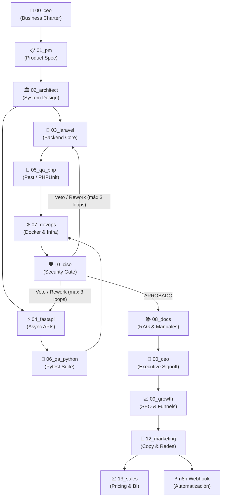

# 🏢 Agent Office — Factoría de Software Autónomo (Cyber-Loft Engine v2.5)

> **Cadena de Montaje de 13 Agentes de IA con LangGraph, FastAPI, SQLite WAL y Frontal 2D en Vanilla JS**

Agent Office es una plataforma integral de desarrollo autónomo de software. Coordina a 13 especialistas de inteligencia artificial (desde la concepción y modelado de negocio hasta el desarrollo backend/frontend, QA multi-stack, auditoría CISO, marketing y despliegue) mediante grafos de estado deterministas (**LangGraph `StateGraph`**), persistencia asíncrona en **SQLite** y un cuadro de mando 2D interactivo con estética **Pixel-Art Cyber-Loft**.

---

## 🚀 Arquitectura del Sistema



---

## 📚 Estrategia Documental Dual (Diátaxis + Notion Live Sync)

Agent Office implementa un flujo documental híbrido y continuo:

1. **Documentación Local en `docs/`:**
   - Estructurada rigurosamente bajo los 4 cuadrantes del **Framework Diátaxis** (Tutoriales, Guías Prácticas, Referencia Técnica y Conceptos).
   - Incluye diagramas Mermaid (`flowchart TD` / `flowchart LR`), tablas de troubleshooting y guías paso a paso de la UI.
   - Capítulos destacados:
     - [`manual_usuario_capitulo_5_security_circuit_breakers.md`](file:///c:/Proyectos%20Docker/agentoffice/langGraph/docs/manual_usuario_capitulo_5_security_circuit_breakers.md) (Gobernanza CISO y cortafuegos).
     - [`manual_usuario_capitulo_6_enrutamiento_llm_y_test_ping.md`](file:///c:/Proyectos%20Docker/agentoffice/langGraph/docs/manual_usuario_capitulo_6_enrutamiento_llm_y_test_ping.md) (Pasarela de LLMs y fallbacks).
     - [`manual_usuario_capitulo_7_marketing_multiproyecto_y_n8n.md`](file:///c:/Proyectos%20Docker/agentoffice/langGraph/docs/manual_usuario_capitulo_7_marketing_multiproyecto_y_n8n.md) (Estrategia de marketing y n8n).

2. **Publicación Nativa en Vivo en Notion (`notion_docs_sync.py`):**
   - El servicio [`app/services/notion_docs_sync.py`](file:///c:/Proyectos%20Docker/agentoffice/langGraph/app/services/notion_docs_sync.py) sincroniza de forma idempotente los manuales locales hacia el espacio de trabajo de Notion configurado (`NOTION_PARENT_PAGE_ID`).
   - Convierte el Markdown en bloques nativos de Notion, preservando diagramas Mermaid como bloques de código renderizables, dividiendo textos largos y paginando en lotes de 100 bloques sin duplicar páginas.

---

## 🧠 Gobernanza de Agentes en Google Antigravity

El repositorio incluye un catálogo de **7 Skills fundamentales** y **6 Workflows operativos** para Google Antigravity:

### Skills en `.agent/skills/`
1. **`fastapi-sqlite-core`:** Patrón RORO, Pydantic v2 estricto, persistencia SQLite WAL y resiliencia en LLM Gateway.
2. **`cybersecurity-appsec-guardian`:** Auditoría AppSec, mitigación de Path Traversal, SSRF, XSS y Circuit Breakers.
3. **`n8n-integration-expert`:** Flujos JSON (`CreateWorkflowPublicDto`), webhooks multi-proyecto y API REST v1.
4. **`docker-compose-infra`:** Contenedores, Compose, redes bridge vs host, persistencia SQLite y deployers.
5. **`vanilla-js-pixel-ui`:** Frontal Vanilla JS ES6+, sanitización con `_esc(s)`, cliente `api.js` y `pixel.css`.
6. **`pytest-zero-network-qa`:** Mocks 100% offline, cobertura en 3 capas (BD, API, Resiliencia) y triple verificación.
7. **`docs-diataxis-curator`:** Framework Diátaxis, sincronización `config.py` <-> `.env.example` y Notion Sync.

### Workflows Operativos en `.agent/workflows/`
- **`/sec-audit`:** Auditoría profunda de ciberseguridad y corrección de vulnerabilidades.
- **`/feature-fullstack`:** Desarrollo completo end-to-end (Base de datos + API + Frontal + Tests).
- **`/n8n-docker-sync`:** Sincronización y validación de automatizaciones n8n y contenedores Docker.
- **`/qa-audit`:** Auditoría de calidad, tests en 3 capas y verificación de no-regresión.
- **`/ui-inspector`:** Inspección, refactorización y aseguramiento estético Pixel-Art de la UI.
- **`/docs-sync`:** Sincronización documental Diátaxis, `.env.example` y publicación en vivo en Notion.

---

## 🛠️ Puesta en Marcha Rápida (Quickstart)

### 1. Variables de Entorno
Copia la plantilla y configura tus credenciales:
```powershell
cp .env.example .env
```

### 2. Despliegue con Docker Compose
Inicia el backend de Agent Office y opcionalmente el motor de automatización n8n:
```powershell
# Iniciar Agent Office en el puerto 8080
docker compose up -d --build

# Iniciar Agent Office + motor n8n en el puerto 5678
docker compose --profile automation up -d --build
```

### 3. Acceso a las Interfaces
- **Virtual Office & Command Center:** `http://localhost:8080/`
- **Dashboard de Operaciones y Telemetría:** `http://localhost:8080/dashboard`
- **Documentación de la API (Swagger UI):** `http://localhost:8080/docs`
- **Consola de Automatización n8n:** `http://localhost:5678/`

---

## 🧪 Pruebas y Aseguramiento de Calidad

De acuerdo con el estándar innegociable de ingeniería de Agent Office, todos los tests se ejecutan **100% offline** (Zero-Network):

```powershell
# 1. Chequeo de formato y estilo
ruff check .

# 2. Análisis estático de tipos estricto
mypy --strict app/

# 3. Suite completa de regresión (19+ fases)
pytest
```
