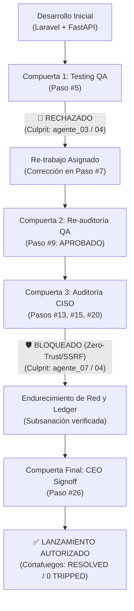

# 📖 Manual de Usuario — AgentOffice (Capítulo 5: Seguridad, Cortafuegos y Gobernanza CISO — Security & Circuit Breakers)

> **Manual de Uso y Guía Visual para Usuarios de Negocio**  
> **Versión de la Aplicación:** AgentOffice v2.5 Cyber-Loft Engine  
> **Destinatarios:** Founders, Directores de Producto, Gestores de Operaciones, Compliance Officers y Auditores de Seguridad  
> **Acceso a la sección:** Clic en la pestaña **🛡️ Security & Circuit Breakers** en la barra superior de navegación.  
> **Enlace directo en Notion:** [Ver página en Notion](https://app.notion.com/p/416be4dde9738147bac6d05de53008ff?pvs=204)  
> **Captura de pantalla oficial:** Verificable en la interfaz interactiva o en el archivo adjunto `12_tab_security_matrix.png`.

---

## 📑 Índice del Capítulo

1. [Propósito de la Matriz de Seguridad y Cortafuegos (Security & Circuit Breakers)](#1-propósito-de-la-matriz-de-seguridad-y-cortafuegos-security--circuit-breakers)
2. [Cabecera de Mando y Estado Global del Escudo (CISO CyberShield)](#2-cabecera-de-mando-y-estado-global-del-escudo-ciso-cybershield)
3. [Las 3 Directrices y Certificaciones de Cumplimiento Normativo](#3-las-3-directrices-y-certificaciones-de-cumplimiento-normativo)
4. [Panel Izquierdo: Monitoreo de Proyectos y Estado de Cortafuegos (Circuit Breakers)](#4-panel-izquierdo-monitoreo-de-proyectos-y-estado-de-cortafuegos-circuit-breakers)
5. [Panel Derecho: Pista de Auditoría Forense (Audit Trail de Seguridad CISO & QA)](#5-panel-derecho-pista-de-auditoría-forense-audit-trail-de-seguridad-ciso--qa)
6. [Caso Práctico Real: Cómo se Resolvieron los 5 Vetos en `validator-hq-saas`](#6-caso-práctico-real-cómo-se-resolvieron-los-5-vetos-en-validator-hq-saas)
7. [Preguntas Frecuentes y Guía de Decisiones para Negocio](#7-preguntas-frecuentes-y-guía-de-decisiones-para-negocio)

---

## 1. Propósito de la Matriz de Seguridad y Cortafuegos (Security & Circuit Breakers)

En una factoría de software autónoma donde 13 agentes de inteligencia artificial colaboran a gran velocidad, los dos mayores riesgos para un directivo, inversor o responsable de negocio son:

1. **Los bucles infinitos de coste o re-trabajo:** Que dos o más agentes entren en un ciclo interminable de discusiones ("yo programo esto", "yo te lo rechazo", "lo vuelvo a programar"), consumiendo miles de tokens y presupuesto de la empresa sin llegar jamás a una conclusión.
2. **El lanzamiento a producción de software inseguro o infractor:** Que el equipo publique una aplicación con fugas de datos de clientes, fallos de red o infracciones del Reglamento General de Protección de Datos (**RGPD**) o del **EU AI Act**.

Para blindar tu empresa ante ambos riesgos existe la pestaña **`🛡️ Security & Circuit Breakers`**. 

Esta pantalla no es una consola de código para programadores; es el **cuadro de mando de gobernanza preventiva y compliance corporativo**. Actúa como el departamento de auditoría interna de un banco o una fábrica aeroespacial, garantizando que:
- Ningún proyecto gaste más dinero del permitido gracias a los **interruptores automáticos (Circuit Breakers)**.
- Ninguna línea de código salga a producción sin el visto bueno explícito e incorruptible del **Agente 10 (CISO Security)** y de los auditores de calidad (**QA PHP y QA Python**).
- Exista una **pista de auditoría legal y transparente** con nombres y apellidos (el agente culpable exacto) en caso de veto preventivo.


---

## 2. Cabecera de Mando y Estado Global del Escudo (CISO CyberShield)

En la franja superior de la pantalla se ubica la cabecera ejecutiva de ciberseguridad:

```text
┌────────────────────────────────────────────────────────────────────────────────────────────────────────────────────────┐
│ 🛡️ CISO CyberShield & Circuit Breaker Matrix                                                                           │
│    Prevención de bucles infinitos, aislamiento RGPD y veto ejecutivo automático.                                       │
│                                                                                                                        │
│  [ 🛡️ SHIELD ACTIVE (0 TRIPPED) ]   Proyecto: [ validator-hq-saas (proj_88c9fd46)  ▼ ]   [ 🔄 Actualizar ]             │
└────────────────────────────────────────────────────────────────────────────────────────────────────────────────────────┘
```

### Controles Principales:
- **Insignia Dinámica de Escudo (`#security-shield-badge`):**
  - **`🛡️ SHIELD ACTIVE (0 TRIPPED)` (Verde Esmeralda Sólido):** Significa que el perímetro de seguridad está completamente protegido y no hay ningún proyecto congelado por bucle infinito ni bloqueo activo en este momento.
  - **`⚠️ CIRCUIT BREAKER (X TRIPPED)` (Rojo Carmesí Parpadeante):** Te avisa al instante si uno o más proyectos han superado el límite de seguridad y han sido congelados para evitar pérdidas financieras.
- **Selector Desplegable de Proyecto (`Proyecto: ...`):** Te permite aislar los registros para auditar un producto concreto (ej. `validator-hq-saas`) o seleccionar *Todos los Proyectos* para tener una perspectiva global de toda tu factoría.
- **Botón `🔄 Actualizar`:** Consulta la base de datos de auditoría en tiempo real y refresca los indicadores sin recargar la página.

---

## 3. Las 3 Directrices y Certificaciones de Cumplimiento Normativo

Justo debajo de la cabecera se presentan las 3 directrices fundamentales que la factoría aplica de forma automatizada por diseño (*Governance-as-Code*):

| Directriz Corporativa | Valor / Nivel | ¿Qué significa en lenguaje sencillo? | Impacto directo en tu negocio |
| :--- | :---: | :--- | :--- |
| **Límite Máximo de Iteraciones** | **3 Loops (Anti-Bucle)** | **El interruptor magnetotérmico.** Si un programador no consigue pasar los controles de calidad tras 3 intentos sucesivos, el sistema detiene el proyecto de inmediato. | Protege tu presupuesto de costes imprevistos de LLM y evita que el sistema se quede "pensando" indefinidamente sin supervisión. |
| **Doctrina Zero-Touch Compliance** | **100% CUMPLIDO** | **Autoservicio total y soberano.** La factoría funciona sin intermediarios humanos manuales, comerciales ni llamadas de ventas. | Los proyectos se especifican, construyen y verifican de forma desatendida a una fracción del coste y tiempo del mercado. |
| **Privacidad RGPD & EU AI Act** | **ENFORCED BY-DESIGN** | **Aislamiento y minimización.** Los datos de cada proyecto se almacenan en espacios herméticos independientes y cada decisión de la IA queda registrada. | Tu empresa cumple de forma nativa con la normativa europea de protección de datos e inteligencia artificial ante cualquier inspección. |

> 💡 **Metáfora del Circuit Breaker (Cortafuegos):** Imagina el cuadro eléctrico de tu oficina. Si un electrodoméstico sufre un cortocircuito, el interruptor diferencial "salta" de golpe para que no se queme toda la instalación. Un *Circuit Breaker* en AgentOffice hace exactamente lo mismo: si un desarrollo se atasca, congela ese proyecto específico sin afectar al resto de la factoría y solicita tu decisión ejecutiva.

---

## 4. Panel Izquierdo: Monitoreo de Proyectos y Estado de Cortafuegos

La columna izquierda (**5 columnas de ancho**) muestra el listado de proyectos registrados en la factoría y el estado en el que se encuentra su mecanismo de parada preventiva:

```text
┌────────────────────────────────────────────────────────┐
│ ⚡ Proyectos Monitoreados                [ 1 proyecto ] │
├────────────────────────────────────────────────────────┤
│ proj_88c9fd46  [ LANZAMIENTO_AUTORIZADO ]              │
│ Loop: 3/3  •  Veredicto: APROBADO        [ ✅ RESOLVED ]│
└────────────────────────────────────────────────────────┘
```

### Anatomía de la Tarjeta de Proyecto:
1. **Identificador del Proyecto:** Código único del espacio de trabajo (ej. `proj_88c9fd46`).
2. **Insignia de Estado Técnico:** Indica el hito actual alcanzado en la cadena de montaje (ej. `LANZAMIENTO_AUTORIZADO`, `SISTEMA_DISENO_UI_LISTO` o `BLOQUEADO_POR_CIBERSEGURIDAD`).
3. **Contador de Bucles (`Loop: X/3`):** Te muestra en qué ronda de refinamiento se encuentra. Por ejemplo, `Loop: 3/3` indica que el proyecto agotó su ciclo de perfeccionamiento antes de presentarse al CEO.
4. **Veredicto Final:** El dictamen emitido por el último inspector en intervenir (`APROBADO`, `RECHAZADO` o `BLOQUEADO`).
5. **Insignia del Cortafuegos (Semáforo de Seguridad):**

| Insignia de Cortafuegos | Color Visual | Estado Operativo | ¿Qué debes hacer? |
| :--- | :--- | :--- | :--- |
| **`✅ RESOLVED`** | **Verde Esmeralda** | **Subsanado y Exitoso.** El proyecto tuvo alertas o correcciones durante su desarrollo, pero el equipo técnico corrigió todas las incidencias y el producto recibió la autorización final de lanzamiento. | Ninguna acción. El software está listo para comercializarse. |
| **`🟢 NORMAL`** | **Gris / Azul Tenue** | **Flujo Limpio.** El proyecto se está ejecutando en su primera o segunda pasada sin haber disparado ninguna parada preventiva. | Monitorizar normalmente desde el *Activity Log*. |
| **`⚠️ TRIPPED`** | **Rojo Carmesí Pulsante** | **Cortafuegos Disparado.** El proyecto ha sido detenido preventivamente porque alcanzó 3 intentos fallidos sin superar la auditoría o porque el CISO ordenó una paralización total no resuelta. | Abrir la pestaña *🧠 Agent Thoughts* para revisar los requerimientos del CISO y desbloquear el flujo. |

---

## 5. Panel Derecho: Pista de Auditoría Forense (Audit Trail CISO & QA)

La columna derecha (**7 columnas de ancho**) funciona como la **caja negra de seguridad** de la compañía. En ella se registra en orden cronológico inverso cada objeción, rechazo o veto formulado por las tres figuras que custodian la calidad y la ley en la factoría: el **Agente 10 (CISO Security)**, el **Agente 05 (QA PHP)** y el **Agente 06 (QA Python)**.

```text
┌────────────────────────────────────────────────────────────────────────────────┐
│ 🚨 Audit Trail de Seguridad & Reworks CISO / QA                   [ 5 eventos ]│
├────────────────────────────────────────────────────────────────────────────────┤
│ 🛡️ [CRITICAL] agente_10_ciso                            2026-11-01 11:16:13 UTC │
│ [BLOQUEADO] 🛡️ Informe de Auditoría de Ciberseguridad Ofensiva y Dictamen      │
│ CISO: Clasificación: Confidencial / Pre-Lanzamiento Comercial                   │
│ ────────────────────────────────────────────────────────────────────────────── │
│ Proyecto: proj_88c9fd46                             [ Culprit: agente_04_fastapi ] │
└────────────────────────────────────────────────────────────────────────────────┘
```

### Componentes de Cada Registro de Auditoría:
1. **Icono y Nombre del Auditor:**
   - `🛡️ [CRITICAL] agente_10_ciso`: Alerta de máxima severidad impuesta por el Oficial de Seguridad.
   - `⚡ [CRITICAL] agente_06_qa_python`: Detección de defecto bloqueante en el motor asíncrono o tests Pytest.
   - `🐘 [CRITICAL] agente_05_qa_php`: Detección de vulnerabilidad o fallo mayor en el core transaccional Laravel.
2. **Fecha y Hora UTC:** Momento exacto en el que se formuló la objeción, garantizando no-repudio legal.
3. **Dictamen Ejecutivo:** Resumen directo y legible del motivo de la detención redactado por el auditor (ej. colisión en la máquina de estados, vulnerabilidad de red Zero-Trust, o falta de validación de entradas).
4. **Píldora del Responsable Culpable (`Culprit: ...`):**
   - Esta es una de las mayores innovaciones de AgentOffice: **la imputación directa de responsabilidad técnica**.
   - En una empresa humana tradicional, cuando un proyecto se rompe, los departamentos suelen culparse unos a otros ("es culpa de sistemas", "no, es culpa de los de backend"). 
   - En AgentOffice, el auditor forense señala **exactamente qué especialista originó el fallo** (por ejemplo, `agente_04_fastapi` por un fallo de importación o `agente_07_devops` por una mala configuración de puertos Docker).

---

## 6. Caso Práctico Real: Cómo se Resolvieron los 5 Vetos en `validator-hq-saas`

Para comprender el inmenso valor de esta pantalla en el día a día, analicemos el caso real registrado en tu proyecto **`validator-hq-saas (proj_88c9fd46)`** visible en la pantalla actual:



### Secuencia de Acontecimientos Documentada en la Matriz:
1. **Paso #5 — QA PHP y QA Python detectan defectos críticos:**
   - `agente_05_qa_php` rechaza la entrega de `agente_03_laravel` por riesgo de condiciones de carrera en el balance de créditos.
   - `agente_06_qa_python` rechaza la entrega de `agente_04_fastapi` porque detectó una excepción silenciosa que impedía confirmar trabajos ante Redis.
2. **Pasos #13, #15 y #20 — El CISO impone 3 bloqueos de seguridad estrictos:**
   - El Agente 10 detectó que los contenedores exponían puertos internos sin autenticación y ordenó un **BLOQUEO INMEDIATO** señalando como culpable a `agente_07_devops`.
   - Más adelante, detectó un vector de *Server-Side Request Forgery (SSRF)* en la resolución de dominios DNS y bloqueó nuevamente a `agente_04_fastapi` hasta su blindaje.
3. **Paso #26 — Resolución y Luz Verde:**
   - Lejos de ocultar los errores, los desarrolladores corrigieron cada punto auditado.
   - El CISO levantó los bloqueos y el CEO emitió el acta de cierre `LANZAMIENTO_AUTORIZADO`.
   - Como resultado, el indicador muestra con orgullo **`✅ RESOLVED` con `0 TRIPPED`**: la factoría no tuvo un "camino fácil ficticio", sino una validación de seguridad de grado bancario que resistió 5 rondas de inspección antes de salir a la venta.

---

## 7. Preguntas Frecuentes y Guía de Decisiones para Negocio

### ¿Tener eventos rojos en el *Audit Trail* significa que el software es de mala calidad?
**Al contrario.** En auditoría de software, un sistema que siempre aprueba todo al 100% en la primera pasada suele sufrir de "falsa complacencia" (pruebas superficiales que ignoran vulnerabilidades graves). Que el CISO y los QAs hayan rechazado y bloqueado 5 entregas demuestra que **los inspectores son rigurosos e incorruptibles**. Lo relevante es que al final el proyecto figure en **`RESOLVED`**, lo que certifica que todos los riesgos fueron subsanados.

### ¿Qué debo hacer si veo un proyecto con la insignia `⚠️ TRIPPED`?
Significa que el cortafuegos automático ha actuado para protegerte. Debes:
1. Mirar el panel derecho y comprobar qué agente es el `Culprit` (responsable).
2. Ir a la pestaña **`🧠 Agent Thoughts`** y seleccionar a dicho agente o al CISO para leer la explicación completa.
3. Si lo consideras oportuno, puedes redactar una instrucción en **`💬 Interaction & Pipeline`** indicándole al equipo cómo deseas resolver el conflicto de negocio.

### ¿Puedo utilizar los datos de esta pantalla para demostrar conformidad ante auditores externos o inversores?
**Sí, absolutamente.** Esta pestaña y su base de datos subyacente constituyen una **evidencia documental de gobernanza**. Demuestra que tu empresa aplica separación de funciones (*SoD*), análisis de vulnerabilidades OWASP previo a producción, aislamiento de datos personales (RGPD) y límites de autonomía algorítmica conformes con la Directiva Europea de Inteligencia Artificial (*EU AI Act*).

---

> 📌 **Siguiente Capítulo del Manual:**  
> Continúa la formación con el **Capítulo 6 (Base de Datos y Repositorio de Archivos — Database & Artifacts)** para aprender a inspeccionar las tablas SQLite del sistema y descargar los documentos y código fuente generados por los agentes.
