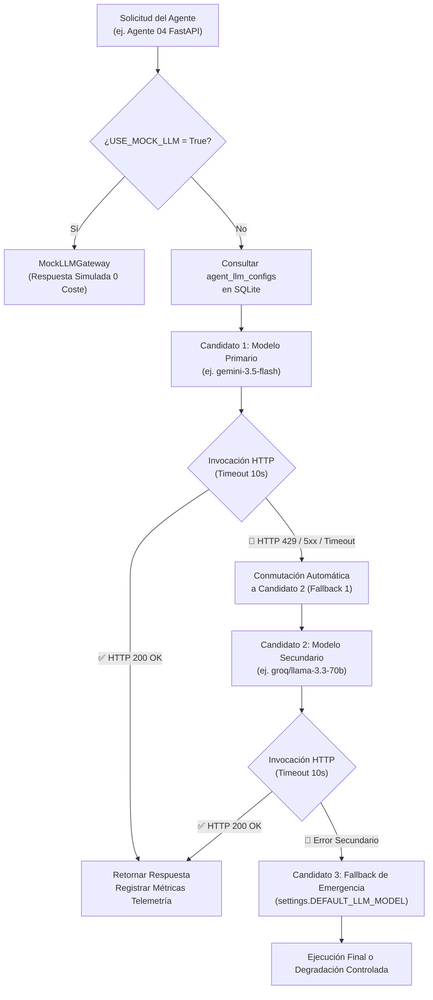

# 📖 Manual de Usuario — AgentOffice (Capítulo 6: Enrutamiento Dinámico de LLMs, Resiliencia y Test de Ping — LLM Gateway & Fallback Chains)

> **Manual de Uso y Guía Visual para Usuarios de Negocio**  
> **Versión de la Aplicación:** AgentOffice v2.5 Cyber-Loft Engine  
> **Destinatarios:** Directores de Tecnología (CTO), Gestores de Operaciones, Finanzas y Arquitectos de Software  
> **Acceso a la sección:** Clic en la pestaña **🤖 Catálogo LLM & Enrutamiento** en el panel lateral Cyber-Loft.  
> **Enlace directo en Notion:** [Ver página en Notion](https://app.notion.com/p/418be4dde9738106a660e49c74c2a610?pvs=204)  
> **Captura de pantalla oficial:** Verificable en la interfaz interactiva en el panel `#tab-llm-routing`.

---

## 📑 Índice del Capítulo

1. [Propósito del Enrutamiento Dinámico y Pasarela Multi-Modelo (LLM Gateway)](#1-propósito-del-enrutamiento-dinámico-y-pasarela-multi-modelo-llm-gateway)
2. [Arquitectura de Persistencia y Catálogo Global (`office_data.sqlite`)](#2-arquitectura-de-persistencia-y-catálogo-global-office_datasqlite)
3. [Flujo de Resolución y Conmutación Automática por Fallback](#3-flujo-de-resolución-y-conmutación-automática-por-fallback)
4. [Anatomía Visual en la Interfaz Cyber-Loft (`panel.js`)](#4-anatomía-visual-en-la-interfaz-cyber-loft-paneljs)
5. [Diagnóstico Seguro: Ping Individual vs. Probar Cadena del Agente](#5-diagnóstico-seguro-ping-individual-vs-probar-cadena-del-agente)
6. [Referencia de Endpoints REST de la Pasarela](#6-referencia-de-endpoints-rest-de-la-pasarela)
7. [Preguntas Frecuentes y Guía de Resolución de Problemas (Troubleshooting)](#7-preguntas-frecuentes-y-guía-de-resolución-de-problemas-troubleshooting)

---

## 1. Propósito del Enrutamiento Dinámico y Pasarela Multi-Modelo (LLM Gateway)

En una factoría de software autónoma que opera de forma continua, depender de un único proveedor de Inteligencia Artificial representa un punto único de fallo (*Single Point of Failure*). Si la API de Google, OpenAI, Anthropic o Groq sufre una caída de servicio, agota su cuota de peticiones o devuelve un error de límite de tasa (**HTTP 429 Too Many Requests**), la factoría entera quedaría paralizada.

Para resolver este desafío de raíz, **Agent Office** incorpora una pasarela centralizada de modelos (**`app/services/llm_gateway.py`**) que garantiza:

- **Soberanía y Multi-Proveedor:** Capacidad de alternar entre Google Gemini (Google AI Studio), Groq (Llama 3.3), Mistral AI, OpenAI, Anthropic y OpenRouter.
- **Tolerancia a Fallos Automática (Self-Healing Fallbacks):** Si el modelo primario asignado a un agente se satura o arroja timeout, la pasarela conmuta de inmediato y de forma transparente al modelo secundario en cuestión de milisegundos.
- **Diagnóstico No Destructivo:** Herramientas de prueba en vivo para certificar la salud de las conexiones sin alterar el estado del proyecto ni incurrir en penalizaciones de cortafuegos.
- **Aislamiento Total Offline (Modo Mock):** Ejecución de tests y auditorías con coste cero de tokens activando `USE_MOCK_LLM=true`.

---

## 2. Arquitectura de Persistencia y Catálogo Global (`office_data.sqlite`)

La pasarela no almacena su configuración en archivos de texto volátiles, sino en tablas dedicadas e indexadas en la base de datos central `office_data.sqlite` gestionada por `app/services/office_store.py`:

### Tablas Principales del Esquema:
1. **`llm_models_catalog`:**
   - Define el inventario global de modelos disponibles en la factoría.
   - Columnas: `model_id` (PK), `display_name`, `provider` (google, groq, mistral, openai, anthropic), `base_url`, `api_key_env`, `tier` (free, paid), `default_temperature`, `default_max_tokens`, `is_active`.
2. **`agent_llm_configs`:**
   - Registra la cadena de modelos asignada individualmente a cada uno de los 15 agentes de la oficina.
   - Columnas: `agent_id` (PK, ej. `agente_01_pm`), `assigned_models` (JSON con lista ordenada de modelos primarios y secundarios con su flag `enabled`), `temperature`, `max_tokens`, `max_retries`, `updated_at`.

> [!NOTE]
> **Seguridad AppSec:** La base de datos almacena el *nombre de la variable de entorno* (`api_key_env`), **jamás la clave secreta en texto plano**. Cuando la API devuelve el catálogo a la interfaz gráfica, solo emite el indicador de disponibilidad `has_api_key: true/false`.

---

## 3. Flujo de Resolución y Conmutación Automática por Fallback

Cuando un agente del grafo (por ejemplo, el `Agente 04 FastAPI`) requiere generar código o analizar una arquitectura, la petición atraviesa la siguiente canalización determinista:



### Reglas de Aislamiento de Proveedores:
- **Respeto de Semáforo y Rate Limit:** Si está configurado `RATE_LIMIT_DELAY_SECONDS > 0`, la pasarela impone un semáforo asíncrono (`asyncio.Semaphore(1)`) para evitar saturar cuotas de capas gratuitas.
- **Captura Estructurada de Errores:** Errores como `HTTP 401 Unauthorized` (clave no configurada) saltan de inmediato al siguiente modelo disponible sin provocar excepciones no controladas.

---

## 4. Anatomía Visual en la Interfaz Cyber-Loft (`panel.js`)

Al abrir la pestaña **🤖 Catálogo LLM & Enrutamiento** en el panel lateral, el usuario visualiza dos bloques operativos:

```text
┌──────────────────────────────────────────────────────────────────────────────┐
│ 🤖 CATÁLOGO GLOBAL DE MODELOS LLM                        [ + Añadir Modelo ] │
├──────────────────────────────────────────────────────────────────────────────┤
│ Gemini 3.5 Flash   [ Google ]  [ FREE ]  [ Key: Configurada 🟢 ] [⚡ Ping ]   │
│ Llama 3.3 70B      [ Groq ]    [ FREE ]  [ Key: Configurada 🟢 ] [⚡ Ping ]   │
│ Mistral Large 2    [ Mistral ] [ PAID ]  [ Key: Ausente 🔴 ]     [⚡ Ping ]   │
└──────────────────────────────────────────────────────────────────────────────┘
┌──────────────────────────────────────────────────────────────────────────────┐
│ 🔀 CADENAS DE FALLBACK POR AGENTE                                            │
├──────────────────────────────────────────────────────────────────────────────┤
│ 📋 Agente 01 (PM)                                                            │
│   Primario:   [ gemini-3.5-pro          ▼ ]  Temp: 0.2                       │
│   Fallback 1: [ llama-3.3-70b-versatile ▼ ]                                  │
│   Fallback 2: [ mistral-large-latest    ▼ ]  [⚡ Probar Cadena del Agente ]   │
└──────────────────────────────────────────────────────────────────────────────┘
```

---

## 5. Diagnóstico Seguro: Ping Individual vs. Probar Cadena del Agente

La interfaz provee dos herramientas de verificación en vivo:

### 1. Botón `[⚡ Ping]` (Diagnóstico de Modelo Individual)
- **Ruta invocada:** `POST /api/v1/office/llm/ping`
- **Operativa:** Envía un payload mínimo (`"Responde solo: OK"`, max_tokens=5) directamente al proveedor seleccionado con un timeout estricto de 10 segundos.
- **Resultado:** Muestra la latencia en milisegundos (`latency_ms`), código de estado HTTP y mensaje de diagnóstico.

### 2. Botón `[⚡ Probar Cadena del Agente]` (Diagnóstico de Resiliencia)
- **Ruta invocada:** `POST /api/v1/office/llm/agents/{agent_id}/ping-chain`
- **Operativa:** Realiza un recorrido secuencial por todos los eslabones configurados para el agente (Primario, Fallback 1, Fallback 2), informando el estado de cada uno.

> [!IMPORTANT]
> **¿Por qué los Pings de Diagnóstico NO Penalizan los Circuit Breakers?**  
> Los cortafuegos del CISO (*Circuit Breakers*) solo monitorizan los entregables y compuertas de calidad del flujo de desarrollo del proyecto. Los pings de diagnóstico son **pruebas sintéticas fuera de banda (*out-of-band diagnostics*)**: no modifican el estado del proyecto, no incrementan el contador de bucles (`Loop: X/3`) y están diseñadas para que el operador verifique credenciales de forma totalmente segura.

---

## 6. Referencia de Endpoints REST de la Pasarela

| Método | Endpoint | Descripción | Esquema Retornado |
| :--- | :--- | :--- | :--- |
| `GET` | `/api/v1/office/llm/catalog` | Lista todos los modelos del catálogo con indicador `has_api_key`. | `list[LLMModelCatalogItem]` |
| `POST` | `/api/v1/office/llm/catalog` | Registra un nuevo modelo personalizado en el catálogo. | `LLMModelCatalogItem` |
| `PUT` | `/api/v1/office/llm/catalog/{model_id}` | Modifica temperatura por defecto, estado activo o tier de un modelo. | `LLMModelCatalogItem` |
| `POST` | `/api/v1/office/llm/ping` | Ejecuta un ping sintético aislado contra un modelo específico. | `LLMModelPingResponse` |
| `GET` | `/api/v1/office/llm/agents` | Lista las cadenas de fallback configuradas para todos los agentes. | `list[AgentLLMConfig]` |
| `PUT` | `/api/v1/office/llm/agents/{agent_id}` | Actualiza la lista de modelos asignados y temperatura para un agente. | `AgentLLMConfig` |
| `POST` | `/api/v1/office/llm/agents/{agent_id}/ping-chain` | Diagnostica la cadena completa de contingencia asignada a un rol. | `AgentLLMChainPingResponse` |

---

## 7. Preguntas Frecuentes y Guía de Resolución de Problemas (Troubleshooting)

| Síntoma Observado | Causa Probable | Solución Recomendada |
| :--- | :--- | :--- |
| **El botón `[⚡ Ping]` responde con `HTTP 401 Unauthorized`.** | La clave de API correspondiente no está definida o es inválida en `.env`. | Añade la clave en `langGraph/.env` bajo el nombre indicado en `api_key_env` (ej. `GROQ_API_KEY`) y reinicia el backend. |
| **Aparece `HTTP 429 Rate Limit` recurrente en un modelo gratuito.** | Se han superado las solicitudes por minuto (RPM) de la capa gratuita del proveedor. | Asigna como Fallback 1 un proveedor complementario (ej. alternar entre Gemini y Groq) o incrementa `RATE_LIMIT_DELAY_SECONDS=6.0`. |
| **La cadena del agente reporta `live_connected: false` en todos los eslabones.** | Fallo de conexión a internet o bloqueo DNS en el contenedor Docker. | Verifica conectividad en el host o activa temporalmente `USE_MOCK_LLM=true` en `.env` para operar en modo offline sin dependencias externas. |
| **Los cambios en las cadenas de fallback no se reflejan tras reiniciar el contenedor.** | El volumen de persistencia de SQLite no está mapeado correctamente en Docker. | Comprueba que `docker-compose.yml` monte `./workspaces:/app/workspaces` para preservar `office_data.sqlite`. |
