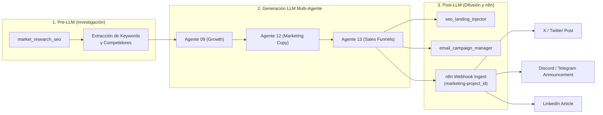

# 📖 Manual de Usuario — AgentOffice (Capítulo 7: Estrategia de Marketing Multi-Proyecto y Automatización n8n — Marketing Hub & n8n Engine)

> **Manual de Uso y Guía Visual para Usuarios de Negocio**  
> **Versión de la Aplicación:** AgentOffice v2.5 Cyber-Loft Engine  
> **Destinatarios:** Founders, Directores de Crecimiento (Growth), Marketing Managers y Especialistas en Automatización  
> **Acceso a la sección:** Clic en la pestaña **📣 Marketing Multi-Canal** en el panel lateral Cyber-Loft.  
> **Enlace directo en Notion:** [Ver página en Notion](https://app.notion.com/p/419be4dde97381a69a4cdd5cfdb670db?pvs=204)  
> **Captura de pantalla oficial:** Verificable en la interfaz interactiva en el panel `#tab-marketing`.

---

## 📑 Índice del Capítulo

1. [Propósito del Motor de Marketing Autónomo y Aprovisionamiento n8n](#1-propósito-del-motor-de-marketing-autónomo-y-aprovisionamiento-n8n)
2. [Arquitectura Multi-Proyecto y Segregación de Cuentas (`office_data.sqlite`)](#2-arquitectura-multi-proyecto-y-segregación-de-cuentas-office_datasqlite)
3. [Control de Omisión en el Orquestador y Ejecución Bajo Demanda](#3-control-de-omisión-en-el-orquestador-y-ejecución-bajo-demanda)
4. [Ciclo de Vida de Marketing: Fases Pre-LLM, LLM y Post-LLM](#4-ciclo-de-vida-de-marketing-fases-pre-llm-llm-y-post-llm)
5. [Integración n8n: Conectores Directos vs. Contenedor Docker](#5-integración-n8n-conectores-directos-vs-contenedor-docker)
6. [Generación de Workflows (`CreateWorkflowPublicDto`) y Materialización](#6-generación-de-workflows-createworkflowpublicdto-y-materialización)
7. [Referencia de Endpoints REST de Marketing y n8n](#7-referencia-de-endpoints-rest-de-marketing-y-n8n)
8. [Preguntas Frecuentes y Guía de Resolución de Problemas (Troubleshooting)](#8-preguntas-frecuentes-y-guía-de-resolución-de-problemas-troubleshooting)

---

## 1. Propósito del Motor de Marketing Autónomo y Aprovisionamiento n8n

Construir software de alta calidad no es suficiente si nadie conoce el producto. Tradicionalmente, tras finalizar un desarrollo, una empresa debe contratar agencias de marketing, redactar notas de prensa, diseñar publicaciones en redes sociales y programar campañas de correo de forma manual y fragmentada.

**Agent Office** resuelve esto transformando la factoría en un **generador de ingresos autónomo**. Mediante la colaboración entre los agentes especialistas:
- **`Agente 09 (Growth & RAG):`** Define la propuesta de valor y las palabras clave SEO de alto impacto.
- **`Agente 12 (Marketing & Copywriting):`** Redacta hilos para X/Twitter, posts técnicos para Dev.to/LinkedIn y notas de lanzamiento.
- **`Agente 13 (Sales BI & Analytics):`** Diseña funnels de conversión, precios escalonados y modelos de atribución.
- **`Motor de Automatización n8n:`** Recibe los entregables mediante un Webhook exclusivo por proyecto y orquesta las publicaciones en canales externos de forma desatendida.

---

## 2. Arquitectura Multi-Proyecto y Segregación de Cuentas (`office_data.sqlite`)

La factoría permite gestionar múltiples proyectos en paralelo (`proj_alpha`, `proj_beta`), cada uno con sus propias cuentas sociales, audiencias y webhooks independientes:

### Persistencia en SQLite (`project_marketing_configs`):
Cada proyecto cuenta con un registro serializado en formato JSON tipado (`ProjectMarketingProfile`) que almacena:
- `project_id` (PK): Identificador del espacio de trabajo.
- `marketing_enabled`: Booleano que activa o congela la ejecución del marketing.
- `marketing_type`: Tipo de producto (`saas_b2b`, `b2c_mobile`, `developer_tool`, `ecommerce`).
- `channels`: Lista de canales configurados (Twitter/X, LinkedIn, Discord/Telegram, Reddit, Dev.to, Email Resend) con sus respectivas credenciales y estado `enabled`.
- `tools`: Herramientas auxiliares de analítica e inyección SEO.

> [!IMPORTANT]
> **Segregación Absoluta:** Las credenciales de marketing (API keys de Twitter o Webhooks de Discord) pertenecen exclusivamente a su `project_id`. El sistema prohíbe terminantemente que un proyecto publique en los canales de otro.

---

## 3. Control de Omisión en el Orquestador y Ejecución Bajo Demanda

El orquestador central gobernado por LangGraph (`app/graph/router.py`) respeta la directriz de negocio del usuario:

1. **Omisión en Pipeline Automático:** Si al crear un proyecto se marca `marketing_enabled: false`, el grafo LangGraph finaliza limpiamente tras el signoff del CEO (`Agente 00`) sin invocar a los Agentes 12 y 13, ahorrando tiempo y presupuesto de tokens.
2. **Ejecución Bajo Demanda (On-Demand Trigger):** En cualquier momento posterior, el usuario puede activar y ejecutar el marketing haciendo clic en **⚡ EJECUTAR MARKETING AHORA** en el panel Cyber-Loft o mediante la API (`POST /api/office/marketing/projects/{project_id}/execute`).

---

## 4. Ciclo de Vida de Marketing: Fases Pre-LLM, LLM y Post-LLM

El proceso de generación y difusión de contenidos se estructura en una cadena de montaje de tres fases consecutivas:



---

## 5. Integración n8n: Conectores Directos vs. Contenedor Docker

Agent Office ofrece flexibilidad operativa dual para adaptarse tanto a entornos contenerizados como a despliegues locales:

### Opción A: Contenedor Docker Oficial de n8n con Perfil `automation`
- En `docker-compose.yml`, el servicio `n8n` corre la imagen oficial `n8nio/n8n:latest` en el puerto `5678`.
- Se inicia fácilmente junto con el backend mediante el comando:
  ```powershell
  docker compose --profile automation up -d --build
  ```
- **Persistencia de Datos:** Mantiene el volumen nombrado `n8n_data:/home/node/.n8n` para conservar flujos, credenciales y ejecuciones entre reinicios de contenedor.
- **Healthchecks Activos:** Ambos servicios implementan directivas de salud no bloqueantes con arranque progresivo (*start_period*):
  - **`agentoffice` (Puerto 8080):** `curl -f http://127.0.0.1:8080/health` (intervalo: 15s, timeout: 5s, start-period: 10s).
  - **`n8n` (Puerto 5678):** `wget -q --spider http://127.0.0.1:5678/healthz || exit 1` (intervalo: 15s, timeout: 5s, start-period: 15s).
- **Topología de Red Dual (Bridge vs. Host):**
  - **Llamadas Backend-to-Backend:** El backend de FastAPI resuelve a n8n mediante DNS interno: `N8N_BASE_URL=http://n8n:5678`.
  - **Llamadas Browser/Host:** Los webhooks se exponen al navegador o servicios externos bajo `WEBHOOK_URL=http://localhost:5678/`, resolviendo automáticamente la URL pública sin colisiones de red.

### Opción B: Conectores Directos y Modo Local Resiliente
- Si n8n no está disponible, el servicio genera de forma transparente la URL de webhook local (`http://localhost:5678/webhook/marketing-{project_id}`) y exporta el workflow como archivo JSON importable sin interrumpir el flujo.

---

## 6. Generación de Workflows (`CreateWorkflowPublicDto`), Aprovisionamiento y Fallback

El módulo `app/services/n8n_service.py` genera y aprovisiona flujos de n8n de manera asíncrona y resiliente:

1. **Cumplimiento DTO de n8n:**  
   Garantiza que la carga útil enviada a `POST /api/v1/workflows` solo contenga campos admitidos por la API REST v1/v2 de n8n (`name`, `nodes`, `connections`, `settings`, `nodeGroups`, `staticData`, `pinData`, `projectId`, `parentFolderId`, `shared`, `description`).
2. **Nodo Disparador Aislado:**  
   Define un nodo de tipo `n8n-nodes-base.webhook` con identificador y ruta únicos por proyecto:
   `webhookId: f"marketing-{project_id}"` y `path: f"marketing-{project_id}"` con `responseMode: "onReceived"`.
3. **Flujo de Publicación Automática con Fallback Resiliente:**  
   Tras la creación exitosa del flujo, el servicio emite una petición para activarlo:
   `POST {base_url}/api/v1/workflows/{workflow_id}/publish`
   Si la instancia de n8n corre una versión previa que no implementa `/publish` y retorna un error 404, el servicio conmuta automáticamente a:
   `POST {base_url}/api/v1/workflows/{workflow_id}/activate`
   garantizando la activación inmediata del webhook en cualquier versión de n8n.
4. **Manejo de Excepciones sin Bloqueo:**  
   Si n8n no está accesible o se agota el timeout (`httpx.AsyncClient(timeout=6.0)`), el servicio captura el fallo, registra una advertencia en logs y retorna `live_n8n_connected: false` junto con la configuración local, sin degradar el backend ni emitir errores 500.
5. **Materialización Segura en Disco:**  
   El flujo completo se guarda en `workspaces/{project_id}/marketing/n8n_workflow_{project_id}.json` utilizando `Path.resolve()` y validación contra Path Traversal con `is_relative_to(workspace_root)`.

---

## 7. Referencia de Endpoints REST de Marketing y n8n

| Método | Endpoint | Propósito |
| :--- | :--- | :--- |
| `GET` | `/api/office/marketing/presets` | Obtiene los perfiles predefinidos de marketing (SaaS B2B, B2C, DevTool). |
| `GET` | `/api/office/marketing/projects/{id}` | Recupera la configuración actual de canales y herramientas del proyecto. |
| `PUT` | `/api/office/marketing/projects/{id}` | Actualiza canales habilitados, credenciales de redes y estado activo. |
| `POST` | `/api/office/marketing/projects/{id}/execute` | Despacha la ejecución bajo demanda de las herramientas y canales activos. |
| `GET` | `/api/office/marketing/projects/{id}/n8n-workflow` | Retorna el JSON completo del workflow de n8n generado para descarga manual. |
| `POST` | `/api/office/marketing/projects/{id}/n8n-provision` | Aprovisiona y publica automáticamente el flujo en la API REST de n8n. |

---

## 8. Preguntas Frecuentes y Guía de Resolución de Problemas (Troubleshooting)

| Problema Observado | Causa Probable | Solución Recomendada |
| :--- | :--- | :--- |
| **El botón `[⚙️ Autoconfigurar en n8n]` muestra `Error de red` o timeout.** | El contenedor de n8n no está corriendo o la clave `N8N_API_KEY` es incorrecta. | Ejecuta `docker compose --profile automation up -d` y comprueba que `N8N_API_KEY` en `.env` coincida con la generada en tu consola de n8n. |
| **Las publicaciones no aparecen en el canal de Discord/Telegram.** | La URL del webhook del canal es errónea o expiró. | Verifica la URL en la pestaña de configuración del canal en el panel lateral y utiliza el botón de prueba de conexión. |
| **El workflow en n8n aparece como Inactivo.** | La llamada a `/publish` no se completó tras la creación. | En la consola de n8n (`http://localhost:5678`), abre el workflow `AgentOffice Marketing - {project_name}` y activa el interruptor superior a `Active`. |
| **El orquestador no generó entregables de marketing al terminar el proyecto.** | El proyecto se creó con la opción de marketing deshabilitada. | Haz clic en **⚡ EJECUTAR MARKETING AHORA** en la pestaña de Marketing para disparar la generación bajo demanda en cualquier momento. |
