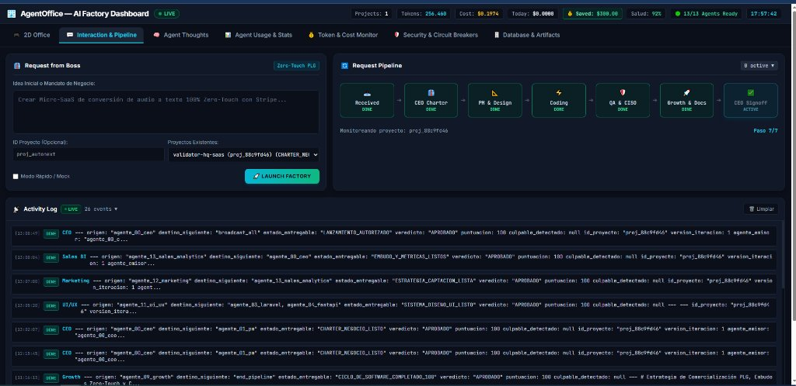
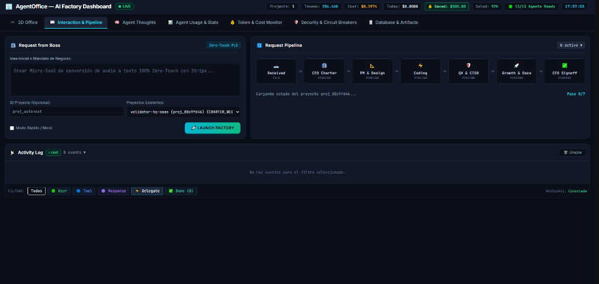

# 📖 Manual de Usuario — AgentOffice (Capítulo 2: Interacción y Pipeline de Producción)

> **Manual de Uso y Guía Visual para Usuarios**  
> **Versión de la Aplicación:** AgentOffice v2.5 Cyber-Loft Engine  
> **Destinatarios:** Founders, Directores de Producto, Gestores de Operaciones y Líderes de Negocio  
> **Acceso a la sección:** Clic en la pestaña **💬 Interaction & Pipeline** en el menú principal (`http://127.0.0.1:8080/`)  
> **Página en Notion:** [📖 Manual de Usuario — Capítulo 2 en Notion](https://app.notion.com/p/415be4dde97381f69617fd6c67f25779)

---

## 📑 Índice del Capítulo
- [1. Propósito del Centro de Interacción y Pipeline](#1-propósito-del-centro-de-interacción-y-pipeline)
- [2. Consola «Request from Boss» (Formulación de Mandatos de Negocio)](#2-consola-request-from-boss-formulación-de-mandatos-de-negocio)
- [3. Línea de Vida «Request Pipeline» (Las 7 Compuertas de Producción)](#3-línea-de-vida-request-pipeline-las-7-compuertas-de-producción)
- [4. Consola «Activity Log» (Seguimiento del Trabajo de los Agentes en Vivo)](#4-consola-activity-log-seguimiento-del-trabajo-de-los-agentes-en-vivo)
- [5. Sistema de Filtros por Categoría de Actividad](#5-sistema-de-filtros-por-categoría-de-actividad)
- [6. Casos Prácticos de Uso Paso a Paso](#6-casos-prácticos-de-uso-paso-a-paso)
- [7. Preguntas Frecuentes y Consejos Prácticos](#7-preguntas-frecuentes-y-consejos-prácticos)

---

## 1. Propósito del Centro de Interacción y Pipeline

La pestaña **💬 Interaction & Pipeline** es la sala de operaciones ejecutiva de AgentOffice. Mientras que la pestaña *🎮 2D Office* te ofrece una representación espacial de tu oficina virtual, este centro de mando está diseñado para la **gestión ejecutiva directa**:

- **Dictar nuevas directrices de software:** Escribir tus ideas en lenguaje natural sin tecnicismos.
- **Supervisar la cadena de montaje:** Verificar en qué etapa de desarrollo se encuentra tu producto (desde la idea inicial hasta la autorización de lanzamiento).
- **Auditar el esfuerzo del equipo:** Leer en tiempo real las decisiones tomadas por los agentes, las herramientas de calidad ejecutadas y los entregables terminados.

---

## 2. Consola «Request from Boss» (Formulación de Mandatos de Negocio)

Ubicada en la esquina superior izquierda (con el distintivo celeste **Zero-Touch PLG**), esta consola representa tu puesto de mando como Director o Fundador («The Boss»).

### Componentes de la Consola:

1. **Caja de Idea Inicial o Mandato de Negocio:**
   Aquí describes qué producto digital deseas que construya la factoría. No necesitas especificar lenguajes de programación ni arquitecturas; redacta tu propuesta de valor, tu público objetivo y cómo monetizará tu software.
   *Ejemplo recomendado:*
   > "Crear un SaaS de conversión de audio a texto para podcasters con pasarela de cobro Stripe, plan gratuito de 30 minutos y suscripción Pro de $19/mes."

2. **Campo ID Proyecto (Opcional):**
   Te permite asignar un identificador memorable a tu software (por ejemplo `proj_audiotext`). Si lo dejas en blanco, la factoría generará un código único automáticamente (ej. `proj_88c9fd46`).

3. **Selector de Proyectos Existentes:**
   Un menú desplegable que te permite conmutar entre diferentes productos creados anteriormente. Al seleccionar un proyecto, todo el panel (Pipeline y Activity Log) se sincroniza de inmediato para mostrar el historial y estado de ese producto.

4. **Casilla «Modo Rápido / Mock»:**
   - **Activada (Recomendado para pruebas):** La factoría ejecuta los agentes de manera ultrarrápida utilizando simulaciones de alta fidelidad. Ideal para comprobar el flujo y verificar la interacción en segundos.
   - **Desactivada (Modo Producción):** Los agentes se conectan con los modelos avanzados de inteligencia artificial (Gemini 3.5 Flash) para redactar el código real de las aplicaciones.

5. **Botón «🚀 LAUNCH FACTORY»:**
   Al pulsarlo, el mandato se envía a la Dirección Ejecutiva de la factoría. El botón cambia temporalmente a estado de conexión y la factoría se pone a trabajar de inmediato sin requerir que intervengas de nuevo.

> 💡 **Consejo de Dirección:** Puedes tener varios proyectos creados y conmutar entre ellos en cualquier momento desde el selector de proyectos. La pantalla nunca perderá tus datos ni reiniciará tu progreso.

---

## 3. Línea de Vida «Request Pipeline» (Las 7 Compuertas de Producción)

A la derecha de la consola se sitúa el **Request Pipeline**, una visualización horizontal que te muestra el paso de tu producto a través de las **7 compuertas de calidad industrial**:

| Etapa | Icono | Especialistas Involucrados | ¿Qué ocurre en esta fase? |
| :--- | :---: | :--- | :--- |
| **1. Received** | 📥 | Dirección General | El mandato de negocio es recibido, registrado y estructurado formalmente en la factoría. |
| **2. CEO Charter** | 👔 | Agente CEO (Director Ejecutivo) | Se redacta el acta fundacional del producto: análisis de viabilidad, cálculo de unit economics y fijación del margen bruto objetivo (≥ 80%). |
| **3. PM & Design** | 📐 | Product Manager, Arquitecto y Diseñador UI/UX | Se define el backlog de tareas, las historias de usuario, la arquitectura técnica de microservicios y el sistema de diseño visual. |
| **4. Coding** | ⚡ | Desarrollador PHP (Laravel), Desarrollador Python (FastAPI) y DevOps | Se escribe el código fuente de los microservicios y se configuran los contenedores Docker listos para desplegar. |
| **5. QA & CISO** | 🛡️ | Especialistas en Testing (Pest y Pytest) y CISO (Seguridad) | Batería automatizada de pruebas unitarias, escaneo de vulnerabilidades, blindaje OWASP y comprobación de políticas de seguridad. |
| **6. Growth & Docs** | 🚀 | Documentador RAG, Marketing TOFU y Ventas BI | Redacción de manuales de usuario, documentación técnica de APIs, embudo de captación de clientes y proyecciones de ingresos. |
| **7. CEO Signoff** | ✅ | CEO (Aprobación Final) | Inspección final de métricas. Si todas las compuertas están aprobadas, el CEO emite el acta de **Lanzamiento Autorizado**. |

### Estados Visuales de cada Etapa:
- **`DONE` (Verde Esmeralda):** Fase superada y validada con éxito.
- **`ACTIVE` (Cyan Brillante con Pulso):** La fase está siendo trabajada en este instante por los agentes.
- **`PENDING` (Gris Oscuro):** Fase en espera de que terminen las etapas previas.

Debajo de las etapas verás el texto informativo (ej. *Monitoreando proyecto: proj_88c9fd46*) y el contador de progreso (*Paso 7/7 (Completado)*).

---

## 4. Consola «Activity Log» (Seguimiento del Trabajo en Vivo)

En la mitad inferior de la pantalla se despliega el **Activity Log**, el feed en tiempo real de todo lo que ocurre dentro de la factoría.

Cada fila del registro representa un hito clave con la siguiente estructura:  
`[Hora HH:MM:SS] [ETIQUETA] [Nombre del Agente] Mensaje descriptivo`

### Las 5 Familias de Eventos:
- **`🟢 USER`:** Entradas del usuario o directrices iniciales formuladas por el Boss.
- **`🔵 TOOL`:** Validaciones ejecutadas con herramientas automáticas (ej. batería de tests Pest en PHP, pruebas asíncronas en FastAPI, escáner de seguridad CISO o comprobación de Docker).
- **`🟣 RESPONSE`:** Entregables concretos generados por los agentes (actas de directriz, esquemas de bases de datos, código fuente).
- **`⚡ DELEGATE`:** Traspasos de responsabilidad entre especialistas (ejemplo: *"CEO delegó a Product Manager"*).
- **`✅ DONE`:** Conclusión y aprobación formal de una compuerta de desarrollo.

---

## 5. Sistema de Filtros por Categoría de Actividad

En la barra inferior del log encontrarás botones de filtrado rápido para enfocar tu atención en lo que más te interese:

- **Todos:** Muestra el flujo completo integrado.
- **🟢 User:** Permite revisar rápidamente las peticiones originales que tú has introducido.
- **🔵 Tool:** Muestra únicamente las pruebas de calidad y auditorías técnicas realizadas.
- **🟣 Response:** Lista los entregables de contenido y especificaciones creados por el equipo.
- **⚡ Delegate:** Muestra el organigrama de delegación y traspaso de tareas.
- **✅ Done:** Filtra las validaciones aprobadas (con contador de hitos completados).

Junto a los filtros, el indicador **Stream: En Vivo (SSE)** te garantiza que la pantalla está conectada directamente con el motor de IA y actualizándose sin necesidad de recargar la página.

---

## 6. Casos Prácticos de Uso Paso a Paso

### Caso 1: Supervisar un Producto ya Desarrollado
1. Haz clic en la pestaña **💬 Interaction & Pipeline**.
2. En el desplegable **Proyectos Existentes**, selecciona el proyecto que deseas consultar (ej. `validator-hq-saas (proj_88c9fd46)`).
3. Verás cómo las 7 compuertas del Pipeline se iluminan en color verde con la etiqueta **`DONE`** y el contador indica **`Paso 7/7 (Completado)`**.
4. En el **Activity Log** podrás navegar por el historial completo de los eventos y entregables que llevaron al éxito de tu software.

### Caso 2: Poner en Marcha un Nuevo Producto Digital
1. Dirígete a la consola **Request from Boss**.
2. En el campo de texto, introduce tu idea de negocio con claridad.
3. Si deseas comprobar el funcionamiento de inmediato, asegúrate de marcar **Modo Rápido / Mock**.
4. Pulsa el botón **🚀 Launch Factory**.
5. Observa cómo el pipeline avanza en tiempo real: la primera etapa pasará a **`ACTIVE`** y el **Activity Log** comenzará a recibir las respuestas y traspasos de tus agentes de forma autónoma.

---

## 7. Preguntas Frecuentes y Consejos Prácticos

### ¿Tengo que permanecer en esta pantalla mientras la factoría trabaja?
No. AgentOffice trabaja de forma 100% autónoma en segundo plano. Puedes moverte libremente a la pestaña **🎮 2D Office** para ver a los agentes en sus escritorios, consultar **🧠 Agent Thoughts** para leer sus reflexiones internas, o minimizar el navegador. Cuando regreses a esta pestaña, todo el avance estará registrado.

### ¿Qué significa que el indicador indique «Stream: En Vivo (SSE)»?
Significa que tu navegador mantiene un canal de comunicación continuo y ultraligero con la factoría digital. Cualquier entregable, prueba de testing o cambio de fase se refleja en tu pantalla al instante sin necesidad de recargar la página.

### ¿Cómo puedo vaciar la pantalla si hay demasiados eventos acumulados?
Puedes pulsar el botón **🗑️ Limpiar** situado en la esquina superior derecha del Activity Log. Esto limpia la vista visual de tu pantalla para trabajar con comodidad, pero **no borra** la base de datos real del proyecto. Para recuperarlos, solo tienes que volver a seleccionar el proyecto en el menú desplegable.
