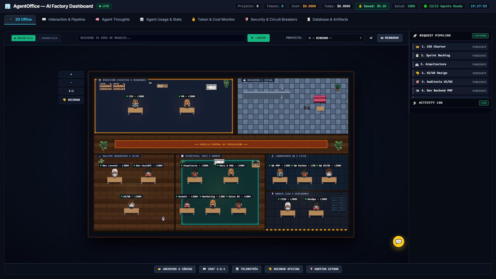
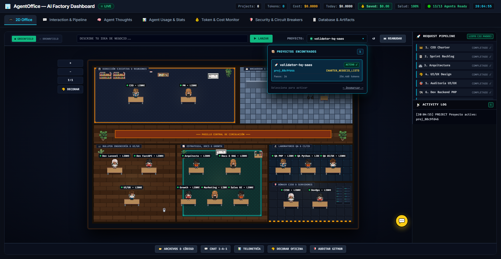
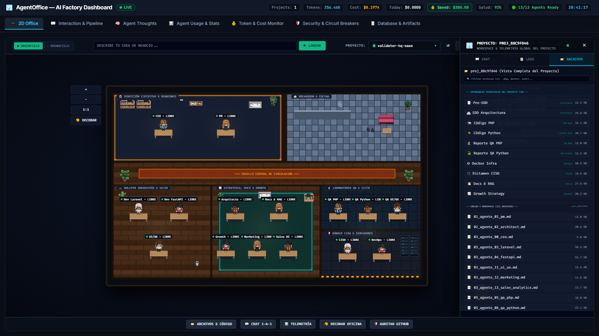
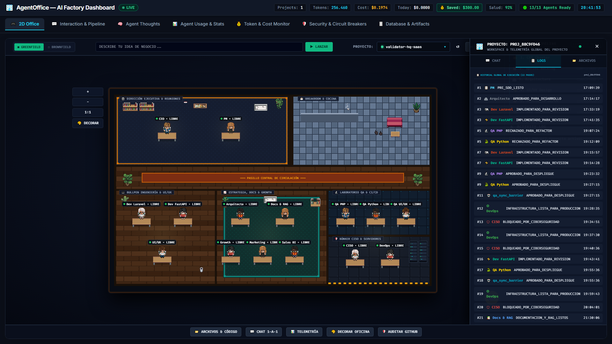
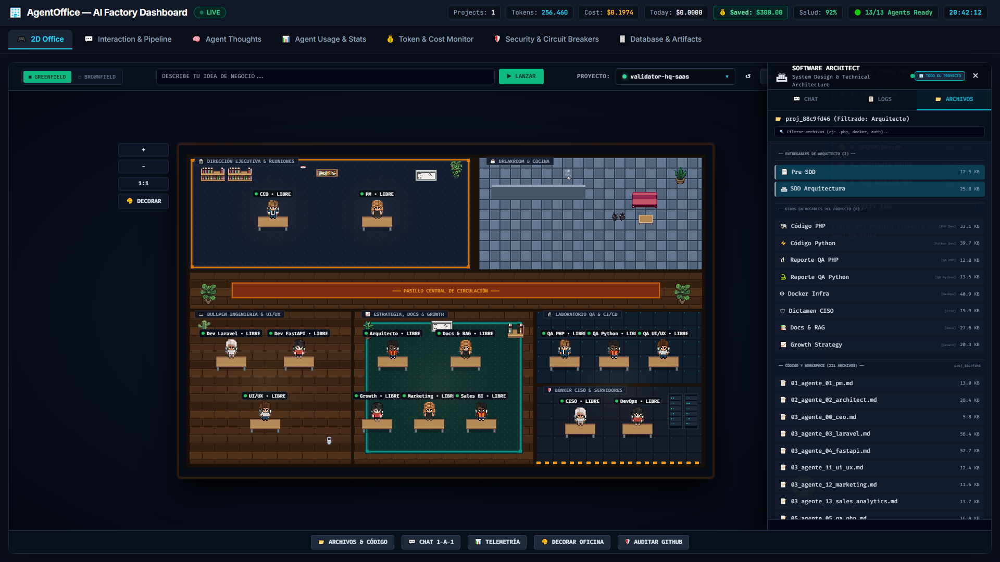
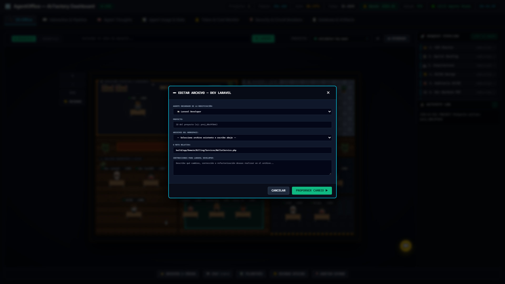

# 📖 Manual de Usuario — AgentOffice (Capítulo 1: Pantalla Principal)

> **Manual de Uso y Guía Visual para Usuarios**  
> **Versión de la Aplicación:** AgentOffice v2.5 Cyber-Loft Engine  
> **Destinatarios:** Founders, Product Managers, Directores de Proyecto y Operadores de Negocio  
> **Acceso a la Aplicación:** `http://127.0.0.1:8080/`  

---

## 📑 Tabla de Contenidos
- [1. Introducción y Filosofía de la Factoría](#1-introducción-y-filosofía-de-la-factoría)
- [2. Cabecera Superior: Barra de Telemetría Global en Vivo](#2-cabecera-superior-barra-de-telemetría-global-en-vivo)
- [3. Barra de Navegación: Las 7 Pestañas de Gestión](#3-barra-de-navegación-las-7-pestañas-de-gestión)
- [4. Pestaña 1 (2D Office): Sub-barra de Mandatos y Selección de Proyectos](#4-pestaña-1-🎮-2d-office-sub-barra-de-mandatos-y-selección-de-proyectos)
- [5. Pestaña 1 (2D Office): Escenario Virtual 2D y Controles de Cámara](#5-pestaña-1-🎮-2d-office-escenario-virtual-2d-y-controles-de-cámara)
- [6. Pestaña 1 (2D Office): Columna Derecha de Operaciones](#6-pestaña-1-🎮-2d-office-columna-derecha-de-operaciones)
- [7. Pestaña 1 (2D Office): Espacio Despejado y Botón Flotante de Chat](#7-pestaña-1-🎮-2d-office-espacio-despejado-y-botón-flotante-de-chat)
- [8. Panel Lateral de Información y Control (Modo Dual)](#8-panel-lateral-de-información-y-control-modo-dual)
- [9. Atajos de Teclado Útiles](#9-atajos-de-teclado-útiles)
- [10. Próximos Capítulos de la Guía](#10-próximos-capítulos-de-la-guía)

---

## 1. Introducción y Filosofía de la Factoría

**AgentOffice** es una factoría digital donde un equipo de **15 especialistas de inteligencia artificial** trabajan de forma coordinada para convertir tus ideas de negocio en productos de software funcionales y listos para salir al mercado.

A diferencia del desarrollo tradicional, AgentOffice opera bajo una doctrina de autonomía inteligente (**Zero-Touch**):

* **Autonomía guiada:** El equipo de IA investiga el mercado, define los modelos de monetización, diseña la arquitectura, redacta el código, realiza pruebas de calidad y redacta la documentación sin requerir que tú escribas una sola línea de código.
* **Respuesta en menos de 60 segundos:** Desde que introduces tu propuesta de negocio, la dirección ejecutiva de la factoría estructura el plan de trabajo y comienza la ejecución de inmediato.
* **Rentabilidad y control financiero:** La factoría vigila en todo momento el gasto computacional (coste de IA) para garantizar que los productos construidos mantengan un margen de beneficio bruto superior al 80%.

> 🎯 **Objetivo de este manual:** Explicar de forma clara, directa y visual cada botón, indicador y ventana de la pantalla principal (`http://127.0.0.1:8080/`), permitiéndote supervisar el progreso de tu software, consultar entregables y comunicarte con tu equipo con total comodidad.

### 📸 Vista General de la Pantalla Principal (🎮 2D Office)

---

## 2. Cabecera Superior: Barra de Telemetría Global en Vivo

La barra superior permanece fija en la parte más alta de la pantalla en todo momento (*sticky top*). Te permite comprobar en cualquier instante el estado de salud del sistema, el gasto acumulado y el número de proyectos en marcha, sin importar en qué pestaña te encuentres.

| Indicador Visual | ¿Qué representa en tu pantalla? | ¿Para qué sirve / Qué decisión te permite tomar? |
| :--- | :--- | :--- |
| **AgentOffice — AI Factory Dashboard** | Nombre y logotipo de la aplicación | Te confirma que estás en el centro de mando principal de la factoría. |
| **Badge `● LIVE`** | Estado de conexión con el servidor | • **`🟢 LIVE`**: Conexión activa y perfecta en tiempo real. • **`🟡 DEGRADED`**: Conexión con lentitud o respuestas parciales. • **`🔴 OFFLINE`**: Sin conexión. Te avisa si se ha detenido el servidor local. |
| **`Projects: 1`** | Contador de proyectos reales activos | Indica cuántos productos SaaS reales están creados en la plataforma. Aísla y oculta automáticamente las pruebas técnicas internas para mostrar solo tus proyectos de negocio reales (como `validator-hq-saas`). |
| **`Tokens: 256,460`** | Volumen total de trabajo cognitivo | Funciona como el "tacómetro" de esfuerzo del equipo (palabras e instrucciones procesadas). Te permite saber cuánto han trabajado los agentes y detectar a tiempo si un proceso estuviera repitiéndose de forma anormal. |
| **`Cost: $0.1974`** | Coste económico total acumulado | Cuantifica el gasto exacto en dólares de las consultas de inteligencia artificial. Te ayuda a comprobar la rentabilidad: fabricar este software ha costado menos de \$0.20 frente a un precio de suscripción habitual de \$19/mes (margen superior al 98%). |
| **`Today: $0.00`** | Gasto realizado durante el día de hoy | Muestra el consumo generado exclusivamente desde las 00:00 del día actual. Es tu termómetro diario para no sobrepasar presupuestos fijados. |
| **`💰 Saved: $300.00`** | Ahorro económico estimado | Calcula el dinero aproximado que has ahorrado en comparación con contratar agencias o programadores por horas para realizar estas mismas tareas. |
| **`Salud: 92%`** | Índice de calidad y éxito del proyecto | Mide el porcentaje de fases y controles de calidad aprobados a la primera por los agentes revisores (24 aprobados de 26 pasos totales). Se muestra en verde esmeralda si supera el 80%, y en ámbar si se requieren revisiones adicionales. |
| **`🟢 13/13 Agents Ready`** | Plantilla de agentes preparados | Confirma que los 13 especialistas del equipo (Dirección, Arquitectura, Diseño, Programación, Calidad, Seguridad, Documentación y Marketing) están presentes en la oficina y listos para trabajar. |
| **Reloj Digital** | Hora en tiempo real (`HH:MM:SS`) | Referencia cronológica para saber a qué hora exacta se ha completado cada fase o entregable del proyecto. |

> 🎯 **¿A quién va dirigida esta telemetría y qué decisiones te ayuda a tomar?**  
> * **Para Founders y Directores de Negocio:** Supervisar la rentabilidad económica del producto, certificar que el gasto en IA sea marginal y verificar que la calidad técnica sea óptima antes de comercializarlo.  
> * **Para Responsables de Producto y Operaciones:** Saber de un vistazo si todo el equipo está disponible y confirmar que ninguna tarea esté bloqueada o consumiendo recursos innecesarios.

---

## 3. Barra de Navegación: Las 7 Pestañas de Gestión

Situada justo debajo de la cabecera de telemetría, esta barra te permite desplazarte rápidamente entre las 7 secciones de la factoría. El cambio es instantáneo y fluido: el mapa de la oficina nunca se reinicia ni se pierde lo que estés viendo.

### 📌 Resumen de Pestañas

- **1. `🎮 2D Office` (Vista Principal por Defecto):**
  - La oficina virtual interactiva. Aquí observas a los agentes en sus puestos de trabajo, lanzas proyectos nuevos o auditorías, supervisas el progreso del pipeline y abres el panel de archivos.
- **2. `💬 Interaction & Pipeline`:**
  - Consola ejecutiva avanzada. Te permite encargar proyectos con configuraciones personalizadas, probar en modo simulado rápido y ver las 7 grandes etapas del ciclo de vida del software.
- **3. `🧠 Agent Thoughts`:**
  - Sala de reflexión interna. Te permite leer los razonamientos de los agentes en tiempo real mientras toman decisiones, aprueban tareas o sugieren mejoras.
- **4. `📊 Agent Usage & Stats`:**
  - Métricas de rendimiento de los agentes: cuántas intervenciones ha realizado cada especialista, cuánto tardan en contestar y su porcentaje de aprobaciones.
- **5. `💰 Token & Cost Monitor`:**
  - Informe financiero detallado: tablas y gráficos de costes desglosados por modelo de lenguaje y tipo de consulta.
- **6. `🛡️ Security & Circuit Breakers`:**
  - Panel de supervisión de riesgos y seguridad: detecta posibles atascos y muestra los controles de protección aplicados por el responsable de seguridad (CISO).
- **7. `🗄️ Database & Artifacts`:**
  - Explorador general de bases de datos y biblioteca de todos los documentos oficiales generados por el equipo.

---

## 4. Pestaña 1 (`🎮 2D Office`): Sub-barra de Mandatos y Selección de Proyectos

Situada en la parte superior del escenario virtual, esta barra reúne todas las herramientas necesarias para poner a trabajar al equipo, abrir archivos y seleccionar el proyecto activo.

### 4.1 Modos de Trabajo: Greenfield vs. Brownfield

- **Botón `■ GREENFIELD`:**
  - *¿Para qué sirve?* Para crear una aplicación o software **desde cero** a partir de una descripción en lenguaje natural.
  - *¿Cómo se activa?* Haz clic sobre él. Se mostrará el campo para escribir tu idea y el botón verde `▶ LANZAR`.
- **Botón `□ BROWNFIELD`:**
  - *¿Para qué sirve?* Para auditar, revisar la seguridad y planificar mejoras sobre un proyecto existente en un repositorio de **GitHub**.
  - *¿Cómo se activa?* Haz clic sobre él. Se ocultará el campo de idea y aparecerán las herramientas de auditoría: campo para la dirección de GitHub, selector de profundidad y botón `🔍 AUDITAR`.

### 4.2 Crear un Proyecto Nuevo (Modo Greenfield)

- **Campo "Describe tu idea de negocio...":**
  - Escribe con tus propias palabras qué producto deseas que construya el equipo.
  - *Ejemplo práctico:* `"Crear una plataforma para que clínicas dentales envíen recordatorios de citas por WhatsApp con confirmación automática y cobro de fianza con Stripe."`
- **Botón `▶ LANZAR`:**
  - Pone en marcha la factoría. El CEO convocará de inmediato al Director de Producto para definir los planes de precios, las funciones imprescindibles y el reparto de tareas.

### 4.3 Auditar un Proyecto Existente de GitHub (Modo Brownfield)

Permite que el equipo examine un repositorio de código existente antes de tomar decisiones sobre su evolución o modernización:

- **Campo "URL del Repositorio":**
  - Pega el enlace de GitHub (por ejemplo, `https://github.com/usuario/mi-proyecto`).
- **Selector de Profundidad de Auditoría:**
  - Te permite elegir entre dos modalidades de análisis:
  - **`⚡ RÁPIDO`:**
    - *¿Qué hace?* Un diagnóstico preliminar en cuestión de segundos. Revisa las dependencias principales y la estructura general del proyecto.
    - *¿Cuándo usarlo?* Si deseas una primera impresión técnica rápida con un consumo mínimo de recursos.
  - **`🔬 PROFUNDO` (Opción Recomendada):**
    - *¿Qué hace?* Una auditoría forense integral. El Responsable de Ciberseguridad (CISO) escanea vulnerabilidades, credenciales expuestas y fallos de configuración. En paralelo, el Arquitecto de Software analiza la estructura interna del código, detecta deuda técnica y propone una hoja de ruta para modernizarlo. Al finalizar, calcula una puntuación global de salud técnica del software (de 0 a 100).
    - *¿Cuándo usarlo?* Antes de incorporar código externo a tu empresa o iniciar una migración importante.
- **Botón `🔍 AUDITAR`:**
  - Inicia la auditoría diagnóstica. Mientras el equipo analiza el repositorio, el botón indicará `⏳ AUDITANDO...`. Al finalizar, el proyecto se añadirá automáticamente a tu lista de proyectos.

### 4.4 Gestión y Selección de Proyectos (Extremo Derecho)

- **Botón `📁 ARCHIVOS & CÓDIGO`:**
  - Integrado de forma cómoda en la barra superior junto al selector de proyectos.
  - *¿Qué ocurre al pulsarlo?* Despliega en el lateral derecho el **Panel de Información del Proyecto** en modo global. Te permite explorar al instante todos los documentos de negocio, diseños, contratos técnicos y archivos de código generados por el equipo, sin necesidad de hacer clic primero sobre ningún agente.
- **Selector Desplegable `PROYECTO:`:**
  - Un menú desplegable moderno y de tamaño fijo (230px) que te muestra el nombre del proyecto activo en ese momento, acompañado de un indicador luminoso (verde pulsante si hay un proyecto seleccionado, gris tenue si no hay ninguno).
  - *Al hacer clic sobre él:* Se abre una ventana flotante con el catálogo completo de proyectos disponibles.
  - *Diseño 100% Opaco y sin transparencias:* La ventana cuenta con un fondo oscuro sólido y bordes luminosos cian, lo que garantiza una lectura impecable sin que los gráficos o muebles de la oficina virtual interfieran con el texto.
  - *Visualización de 3 a 4 tarjetas simultáneas:* La ventana muestra limpiamente entre 3 y 4 proyectos a la vez, con un corte visual elegante en la base que indica que hay más elementos disponibles.
  - *Barra de desplazamiento vertical suave:* Si dispones de más de 3 proyectos, se activa automáticamente una barra de scroll vertical para que navegues por todo tu catálogo con fluidez.
  - *Contenido de cada tarjeta de proyecto:*
    - Icono de proyecto: Cohete `🚀` para proyectos creados desde cero o escudo `🛡️` para auditorías de GitHub.
    - Nombre del producto en negrita (ej. `validator-hq-saas`), acompañado de una etiqueta verde `ACTIVO ✓` en el proyecto seleccionado.
    - Identificador interno del proyecto y su estado operativo actual (ej. `CHARTER_NEGOCIO_LISTO`).
    - Resumen de pasos completados y volumen de trabajo (tokens) consumido.
    - Botón `— Desmarcar —` en la parte inferior para deseleccionar el proyecto actual y volver a la vista neutra.
  - *¿Qué sucede al seleccionar un proyecto?*
    1. La factoría fija de inmediato ese proyecto como el foco de trabajo activo.
    2. La columna de la derecha (`REQUEST PIPELINE`) se actualiza iluminando en verde todas las etapas completadas hasta la fecha para ese proyecto.
    3. Al abrir el panel lateral de archivos o pulsar sobre cualquier agente, verás los documentos, tareas y conversaciones pertenecientes a este proyecto.
    4. Las demás pestañas de la factoría (pensamientos, estadísticas, bases de datos) se sincronizan automáticamente con este proyecto.
- **Botón `↺` (Refrescar Lista):**
  - Consulta en tiempo real las novedades de la factoría y actualiza la lista de proyectos al instante sin tener que recargar la página en tu navegador.
- **Botón `⏭ REANUDAR`:**
  - Si el trabajo en el proyecto se encontraba en pausa o esperando aprobación, pulsar este botón le indica al equipo de IA que continúe con la siguiente fase planificada a partir del último punto guardado.

---

## 5. Pestaña 1 (`🎮 2D Office`): Escenario Virtual 2D y Controles de Cámara

El escenario 2D recrea una oficina digital interactiva donde conviven los 15 miembros del equipo. Cada especialista ocupa un puesto de trabajo asignado a su departamento.

### 5.1 Botonera de Cámara Exterior (Margen Izquierdo)

Situada fuera del mapa en el margen izquierdo para no tapar los puestos de la oficina:

- **Botón `+`:** Acerca la vista para observar con más detalle a los agentes y las salas.
- **Botón `−`:** Aleja la vista para tener una visión panorámica de toda la planta.
- **Botón `1:1`:** Restablece la cámara y el zoom a su posición estándar inicial.
- **Botón `🎨 DECORAR`:** Activa el **Modo de Personalización de Oficina**. Te permite mover mesas y agentes con el ratón, rotar muebles con la tecla `R`, eliminarlos con `Supr` y guardar la decoración que más te guste en tu navegador.

<b>¿Dónde se sienta cada especialista en la oficina?</b>

* **Dirección Ejecutiva y Reuniones (Zona Superior Izquierda):**
  * `👑 CEO`: Estrategia de negocio, asignación de capital y aprobación final.
  * `📋 Director de Producto (PM)`: Coordinación de sprints y desglose de tareas.
* **Zona de Descanso y Cocina (Zona Superior Derecha):**
  * Cafetería y espacio social del equipo.
* **Pasillo Central de Circulación (Centro Horizontal):**
  * Alfombra divisoria y área de tránsito.
* **Área de Desarrollo de Software y Diseño (Zona Inferior Izquierda):**
  * `🐘 Programador Backend (Laravel)`: Desarrollo de servidores y lógica principal.
  * `⚡ Programador Backend (FastAPI)`: Desarrollo de servicios asíncronos en Python.
  * `🎨 Diseñador UI/UX`: Diseño visual, ergonomía y experiencia de usuario.
* **Estrategia, Documentación y Crecimiento (Zona Inferior Centro):**
  * `🏛️ Arquitecto de Software`: Diseño técnico de sistemas y contratos de interfaces.
  * `📚 Responsable de Documentación y RAG`: Manuales de usuario y bases de conocimiento.
  * `📈 Experto en Crecimiento (Growth)`: Estrategias de retención y onboarding rápido.
  * `📣 Especialista en Marketing`: Contenidos comerciales y posicionamiento.
  * `💹 Analista de Ventas y Negocio`: Indicadores de negocio y márgenes financieros.
* **Laboratorio de Calidad y Pruebas (Zona Inferior Derecha Superior):**
  * `🔬 Especialista de Pruebas (PHP)`: Verificación y pruebas automáticas.
  * `🐍 Especialista de Pruebas (Python)`: Pruebas de integración y estabilidad.
  * `🎯 Auditor de Calidad UI/UX`: Revisión de accesibilidad y coherencia visual.
* **Centro de Ciberseguridad e Infraestructura (Zona Inferior Derecha Inferior):**
  * `🛡️ Responsable de Ciberseguridad (CISO)`: Protección contra ataques y fugas de datos.
  * `⚙️ Especialista en DevOps`: Configuración de contenedores Docker y puesta en marcha.

### 5.2 Cómo interactuar con el Escenario

- **Pasar el ratón por encima de un agente:** Se despliega una etiqueta que te indica su nombre y su especialidad.
- **Hacer clic sobre un agente:** Abre de inmediato el **Panel Lateral de Control** centrado en ese especialista, permitiéndote chatear en privado con él o ver los documentos y archivos en los que ha trabajado.

---

## 6. Pestaña 1 (`🎮 2D Office`): Columna Derecha de Operaciones

Ubicada en el lateral derecho de la pantalla, supervisa el avance paso a paso del software y ofrece un registro en vivo de todas las acciones del equipo:

### 6.1 Barra de Progreso del Proyecto (`🚀 REQUEST PIPELINE`)

Muestra las 15 fases obligatorias que recorre la factoría para construir el producto, desde la primera idea hasta la entrega definitiva:

- **`PENDIENTE` (Gris tenue):** Etapa programada que todavía no ha comenzado.
- **`EJECUTANDO` (Azul cian brillante pulsante):** El especialista asignado está trabajando en esta tarea ahora mismo.
- **`COMPLETADO` (Verde esmeralda):** Tarea terminada con éxito y validada por los controles de calidad.

<b>Las 15 Fases de Fabricación del Software</b>

1. **CEO Charter:** Definición del modelo de negocio, planes de precios y márgenes de rentabilidad.
2. **Sprint Backlog:** El Director de Producto desglosa el proyecto en tareas técnicas concretas.
3. **Arquitectura:** El Arquitecto define la estructura del sistema y los contratos de datos.
4. **UI/UX Design:** Diseño de las pantallas, paleta de colores y experiencia de usuario.
5. **Auditoría UI/UX:** Validación de que los diseños sean accesibles e intuitivos.
6. **Dev Backend PHP:** Programación de la base de datos y la lógica principal.
7. **Dev Backend FastAPI:** Programación de servicios rápidos y procesamiento asíncrono.
8. **QA PHP:** Batería de pruebas automáticas para comprobar que la lógica no tenga fallos.
9. **QA Python:** Pruebas de integración y fiabilidad de los microservicios.
10. **Docker & CI/CD:** Preparación de los contenedores para poder instalar y ejecutar la aplicación.
11. **CISO Security:** Análisis de seguridad para certificar que no existen puertas traseras ni vulnerabilidades.
12. **Documentación & RAG:** Redacción de manuales de usuario y guías técnicas de uso.
13. **Growth Hacking:** Mecanismos para que los nuevos clientes entiendan la aplicación en menos de un minuto.
14. **Marketing:** Textos explicativos y estrategias de captación comercial.
15. **CEO Signoff:** Aprobación definitiva del producto por la Dirección Ejecutiva para su lanzamiento.

### 6.2 Registro de Actividad en Vivo (`📡 ACTIVITY LOG`)

Una ventana con desplazamiento automático que registra minuto a minuto cada decisión tomada por los agentes, con fecha, hora exacta e indicaciones visuales claras de éxito, advertencia o finalización.

---

## 7. Pestaña 1 (`🎮 2D Office`): Espacio Despejado y Botón Flotante de Chat

Para ofrecer una experiencia más cómoda, amplia y sin distracciones, la interfaz ha evolucionado organizando los controles de manera más limpia:

- **Espacio de trabajo despejado (Sin barra inferior fija):**
  - La antigua barra inferior ha sido retirada. Ahora el escenario de la oficina virtual cuenta con una mayor altura visible, permitiéndote ver a todos los agentes y salas con total amplitud sin elementos que tapen la vista.
- **Botón Flotante de Chat (Esquina Inferior Derecha):**
  - Situado discretamente en la esquina inferior derecha del mapa de la oficina.
  - Presenta un diseño moderno en titanio oscuro con borde cian iluminado, un icono de conversación táctica y un pequeño indicador LED verde brillante que confirma que **los 13 agentes están activos y listos para conversar**.
  - Al hacer clic en este botón, abres de inmediato el canal de conversación interactivo para hablar con el equipo o con el agente que tengas seleccionado.

---

## 8. Panel Lateral de Información y Control (Modo Dual)

El panel lateral derecho es tu centro neurálgico para consultar documentos, revisar registros de actividad y hablar con los agentes. Cuenta con un **Modo Dual inteligente** que adapta su contenido según lo que necesites consultar:

### 8.1 Modo Proyecto (Vista General de Todo el Proyecto)

Se activa al pulsar el botón **`📁 ARCHIVOS & CÓDIGO`** en la sub-barra superior, o al pulsar el botón de retorno **`[ 🏢 TODO EL PROYECTO ]`**:

- **Cabecera General:** Muestra el nombre y código del proyecto activo bajo el título `WORKSPACE & TELEMETRÍA GLOBAL DEL PROYECTO`.
- **Pestaña `📁 ARCHIVOS`:**
  - **Buscador en tiempo real:** Escribe cualquier término en `🔍 Filtrar archivos...` para encontrar cualquier documento o archivo al instante sin esperas.
  - **Entregables Principales del Proyecto:** Una lista ordenada con los documentos oficiales generados por el equipo (la propuesta de negocio del CEO, los contratos del Arquitecto, los planes de interfaz, el código fuente, los informes de calidad y las directivas de seguridad), indicando qué especialista los elaboró y su tamaño.
  - **Explorador de Archivos:** El árbol de archivos completo organizado con iconos visuales sencillos (código, documentos de texto, configuraciones).
  - Al hacer clic en cualquier archivo, puedes leer su contenido directamente en el visor y utilizar el botón `✏️ EDITAR ARCHIVO` si deseas modificarlo.
- **Pestaña `📋 LOGS`:**
  - Historial secuencial de todos los pasos que el equipo ha completado hasta la fecha para este proyecto. Te indica el número de tarea, el especialista que la ejecutó, el estado y la hora exacta.
- **Pestaña `💬 CHAT`:**
  - Funciona como la **Consola de Dirección Ejecutiva**. Cualquier indicación, duda o mandato que escribas aquí es recibida por la Dirección (CEO), quien se encarga de coordinar la respuesta con el especialista correspondiente.

---

### 8.2 Modo Agente (Vista Individual de un Especialista)

Se activa al hacer clic con el ratón directamente sobre cualquier agente en el mapa de la oficina:

- **Cabecera Personalizada:** Muestra la fotografía del agente, su nombre formal (ej. `SOFTWARE ARCHITECT`), su departamento y su color temático de identificación.
- **Botón de Retorno:** Dispone en la esquina superior derecha del acceso rápido **`[ 🏢 TODO EL PROYECTO ]`**, permitiéndote volver a la vista panorámica global con un solo clic.
- **Pestaña `📁 ARCHIVOS`:**
  - Destaca en primer lugar una sección dedicada: `── ENTREGABLES DE [AGENTE] ──`, mostrándote los documentos y piezas técnicas de las que este profesional es autor directo (por ejemplo, el diseño de arquitectura para el Arquitecto).
  - A continuación presenta los archivos del proyecto relacionados con su área técnica.
- **Pestaña `📋 LOGS`:**
  - Filtra el historial para mostrar únicamente las tareas en las que ha intervenido este agente concreto.
- **Pestaña `💬 CHAT`:**
  - Un canal de conversación privado 1-a-1 con este especialista. Puedes hacerle preguntas sobre su trabajo, pedirle explicaciones sobre una decisión de diseño o encargarle una adaptación específica.

---

### 8.3 Ventana de Edición Rápida de Archivos (`✏️ EDITAR ARCHIVO`)

Accesible desde el visor de archivos o desde el pie del chat:

- **Asignación Automática del Agente Adecuado:** El sistema sugiere de forma inteligente al especialista más cualificado según el archivo que estés editando (por ejemplo, asigna al programador de Laravel si es un archivo de backend, o al especialista de seguridad si es una directiva de protección), aunque tú siempre puedes seleccionar a otro agente si lo deseas.
- **Previsualización de Cambios:** Antes de modificar el archivo en disco, el sistema te muestra exactamente qué líneas se van a añadir (en verde con signo `+`) y cuáles se van a eliminar (en rojo con signo `-`), para que tengas la absoluta certeza de lo que va a ocurrir.
- **Guardado Seguro:** Al pulsar `✓ APLICAR CAMBIO EN DISCO`, el servidor guarda la modificación y genera de forma automática una copia de seguridad (`.bak`) para que nunca pierdas información.

---

## 9. Atajos de Teclado Útiles

> ⌨️ **Atajos de Teclado para Agilizar tu Trabajo:**  
> * `Ctrl + Enter`: Enviar tu mensaje inmediatamente en el campo de texto del chat.  
> * `R`: Rotar el mueble seleccionado cuando te encuentres en el Modo Decoración (`🎨 DECORAR`).  
> * `Supr` o `Backspace`: Eliminar el mueble seleccionado en el Modo Decoración.  
> * `Esc`: Cerrar menús desplegables, ventanas de edición o paneles emergentes.  

---

## 10. Próximos Capítulos de la Guía

- 📖 **[Capítulo 2: Guía de la Consola de Lanzamiento y Fases (`💬 Interaction & Pipeline`)](manual_usuario_interacciones_pipeline.md)** *(Disponible en Notion: [Capítulo 2](https://app.notion.com/p/415be4dde97381f69617fd6c67f25779))*
- 📖 **Capítulo 3:** Manual de Razonamiento y Reflexión de los Agentes (`🧠 Agent Thoughts`)
- 📖 **Capítulo 4:** Cuadro de Mando de Rendimiento y Tiempos de Respuesta (`📊 Agent Usage & Stats`)
- 📖 **Capítulo 5:** Gestión Financiera y Control de Consumos (`💰 Token & Cost Monitor`)
- 📖 **Capítulo 6:** Medidas de Seguridad y Protección del Sistema (`🛡️ Circuit Breakers`)
- 📖 **Capítulo 7:** Consulta de Bases de Datos y Biblioteca de Documentos (`🗄️ Database & Artifacts`)
