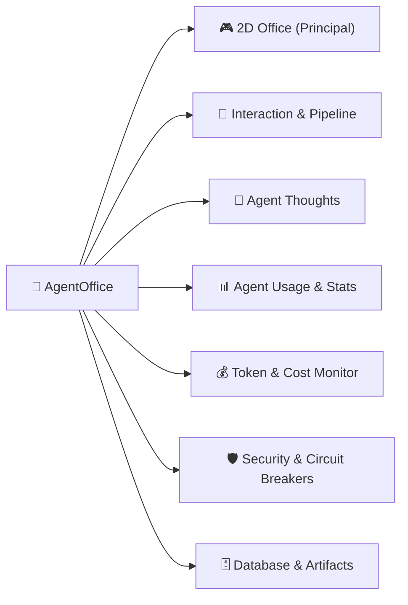

# 🏢 AgentOffice — Manual Oficial de Usuario
## Capítulo 1: Pantalla Principal y Centro de Operaciones (`http://127.0.0.1:8080/`)

> ℹ️ **Documento de Referencia Técnica y Operativa**  
> **Versión de la Aplicación:** AgentOffice v2.5 Cyber-Loft Engine  
> **Destinatarios:** Operadores de Software, Product Managers, Founders y Desarrolladores  
> **Entorno Local:** `http://127.0.0.1:8080/`  

---

## 📑 Tabla de Contenidos (Table of Contents)

- [1. Introducción y Filosofía Operativa](#1-introducción-y-filosofía-operativa)
- [2. Vista General de la Pantalla Principal](#2-vista-general-de-la-pantalla-principal)
- [3. Cabecera Superior: Barra de Telemetría Global en Vivo](#3-cabecera-superior-barra-de-telemetría-global-en-vivo)
- [4. Barra de Navegación: Las 7 Pestañas de Gestión](#4-barra-de-navegación-las-7-pestañas-de-gestión)
- [5. Pestaña 1 (`🎮 2D Office`): Sub-barra de Controles de Lanzamiento](#5-pestaña-1-🎮-2d-office-sub-barra-de-controles-de-lanzamiento)
- [6. Pestaña 1 (`🎮 2D Office`): Escenario Virtual 2D y Controles de Cámara](#6-pestaña-1-🎮-2d-office-escenario-virtual-2d-y-controles-de-cámara)
- [7. Pestaña 1 (`🎮 2D Office`): Columna Derecha de Operaciones](#7-pestaña-1-🎮-2d-office-columna-derecha-de-operaciones)
- [8. Pestaña 1 (`🎮 2D Office`): Barra Inferior de Comandos Rápidos](#8-pestaña-1-🎮-2d-office-barra-inferior-de-comandos-rápidos)
- [9. Paneles Flotantes, Chat 1-a-1 y Modales](#9-paneles-flotantes-chat-1-a-1-y-modales)
- [10. Atajos de Teclado y Consejos de Ergonomía](#10-atajos-de-teclado-y-consejos-de-ergonomía)
- [11. Próximos Capítulos y Enlaces de Profundización](#11-próximos-capítulos-y-enlaces-de-profundización)

---

## 1. Introducción y Filosofía Operativa

**AgentOffice** es una factoría de software autónoma impulsada por **15 agentes de inteligencia artificial** coordinados mediante grafos de estado de **LangGraph**. Su doctrina fundamental es el desarrollo de productos digitales **100% Zero-Touch**:
* **Cero intervención humana obligatoria**: El software se define, planifica, programa, audita y valida automáticamente.
* **Tiempo hasta el primer valor (TTFV) ≤ 60 segundos**: Desde que el usuario formula su idea de negocio hasta que se estructura el charter técnico.
* **Margen bruto neto ≥ 80%**: Cada producto respeta estrictos umbrales de coste descontando comisiones de pago (Stripe 2.9% + $0.30) y consumo de tokens (COGS).

> 🎯 **Objetivo de este manual:** Explicar con precisión cada control, KPI, botón interactivo y panel presente en la pantalla inicial de la aplicación (`http://127.0.0.1:8080/`), proporcionando al usuario una comprensión completa para operar la plataforma con máxima eficiencia.

---

## 2. Vista General de la Pantalla Principal

Al ingresar en `http://127.0.0.1:8080/`, el usuario accede a una consola unificada de consola oscura (`#0b0f19`) inspirada en salas de operaciones técnicas de alta tecnología (*Cyber-Loft*).


La pantalla principal se estructura en **cuatro zonas visuales maestras**:
1. **Cabecera de Telemetría Superior:** Indicadores financieros, de volumen y salud global.
2. **Barra de Navegación de 7 Pestañas:** Acceso instantáneo sin recarga a las herramientas de control y auditoría.
3. **Pestaña Activa Principal (`🎮 2D Office`):**
   * *Sub-barra de mandatos:* Alternador Greenfield/Brownfield, prompt elástico y selector de proyectos.
   * *Botonera exterior de cámara:* Zoom y modo diseño fuera del canvas para no obstruir salas.
   * *Escenario Canvas 2D:* Mapa arquitectónico con 15 agentes interactivos en sus escritorios.
   * *Panel de Operaciones Derecho:* Stepper con los 15 pasos del pipeline y terminal de actividad en vivo.
4. **Dock Inferior Centrado:** Barra de herramientas de comando rápido (Archivos, Chat 1-a-1, Telemetría, Decoración y Auditoría GitHub).

---

## 3. Cabecera Superior: Barra de Telemetría Global en Vivo

La barra superior (`<header>`) permanece anclada en todo momento (*sticky top*), asegurando visibilidad constante del estado del sistema independientemente de la pestaña seleccionada.

| Elemento Visual | Identificador DOM | Tipo de Control | Descripción Funcional y Utilidad |
| :--- | :--- | :--- | :--- |
| **Logo & Título** | `h1` | Identidad Visual | `🏢 AgentOffice — AI Factory Dashboard`. Identifica el entorno de operaciones activo. |
| **Badge `● LIVE`** | `.live-dot` | Estado en Vivo | Parpadea suavemente en verde esmeralda. Confirma que la conexión de polling/websocket con el servidor FastAPI y SQLite está activa y saludable. |
| **Píldora `Projects:`** | `#kpi-projects` | Métrica Numérica | Muestra el **número total de proyectos registrados** en la base de datos SQLite (`office_projects`). Empieza en `0` en instalaciones limpias y sube al crear proyectos. |
| **Píldora `Tokens:`** | `#kpi-tokens` | Métrica Numérica | Contabiliza el **consumo total acumulado de tokens** (Prompt + Completion) procesados por los LLMs a través de las llamadas del grafo. |
| **Píldora `Cost:`** | `#kpi-cost` | Métrica Financiera | Desglose en dólares (`$0.0000`) del **coste de cómputo acumulado**. Se calcula de manera determinista según las tarifas vigentes por millón de tokens de cada modelo LLM utilizado. |
| **Píldora `Today:`** | `#kpi-today` | Métrica Financiera | Coste generado **exclusivamente durante el día actual** (desde las 00:00:00 UTC). Permite monitorizar presupuestos diarios y evitar sorpresas de facturación. |
| **Píldora `💰 Saved:`** | `#kpi-saved` | ROI Estimado | Indicador destacado con borde esmeralda. Cuantifica el **ahorro estimado en dólares** comparado con el coste de consultoría y desarrollo de software tradicional. |
| **Píldora `Salud:`** | `#kpi-health` | Índice de Calidad | Puntuación de salud del sistema (`100%` en verde; <`80%` en ámbar si hay compuertas de calidad suspendidas o Circuit Breakers activos). |
| **Píldora `🟢 Agents Ready`** | `#kpi-agents` | Topología de Red | Muestra `13/13 Agents Ready` (o el total de nodos compilados en el StateGraph). Valida que todos los agentes están inicializados y a la espera de mandatos. |
| **Reloj Digital** | `#live-clock` | Tiempo Real | Muestra la hora local del sistema (`HH:MM:SS`) con precisión de segundo, sirviendo de referencia cronológica para logs y auditorías. Cierra el margen derecho de la cabecera. |

> 💡 **Regla de Cero Falsos Positivos:** Ningún número de esta cabecera es estático ni inventado. Si el sistema no ha procesado proyectos en su base de datos local, mostrará estrictamente `0` y `$0.0000`.

---

## 4. Barra de Navegación: Las 7 Pestañas de Gestión

Ubicada justo debajo de la cabecera principal, esta barra permite conmutar de manera instantánea entre las 7 dimensiones de la factoría. El cambio se ejecuta mediante clases CSS (`hidden`), garantizando que **el canvas 2D nunca se destruye ni se pierde el estado de ejecución**.



### 📌 Resumen de Pestañas y Enlaces a Guías de Profundización:

* **1. `🎮 2D Office` (Vista Actual)**:
  * *Contenido:* Plano visual interactivo, sub-barra de mandatos, Request Pipeline y terminal en vivo.
* **2. `💬 Interaction & Pipeline`**:
  * *Resumen:* Consola ejecutiva *"Request from Boss"* para especificar ideas con identificadores manuales, activar el *Modo Rápido / Mock* y supervisar las 7 macro-etapas del pipeline.
  * 🔗 [Ver Guía Detallada: Pestaña Interaction & Pipeline ↗](#11-próximos-capítulos-y-enlaces-de-profundización)
* **3. `🧠 Agent Thoughts`**:
  * *Resumen:* Monitor forense en tiempo real donde se leen los razonamientos internos del LLM (*Chain-of-Thought*), clasificados por veredictos (`APROBADO`, `REWORK`) e inspector de System Prompts.
  * 🔗 [Ver Guía Detallada: Pestaña Agent Thoughts ↗](#11-próximos-capítulos-y-enlaces-de-profundización)
* **4. `📊 Agent Usage & Stats`**:
  * *Resumen:* Cuadro de mando estadístico con tarjetas métricas individuales por agente: total de ejecuciones, tiempo medio de respuesta y tasa de acierto en compuertas de calidad.
  * 🔗 [Ver Guía Detallada: Pestaña Agent Usage & Stats ↗](#11-próximos-capítulos-y-enlaces-de-profundización)
* **5. `💰 Token & Cost Monitor`**:
  * *Resumen:* Auditoría financiera pormenorizada con tablas de consumo de tokens *Input/Output* por modelo y gráficos de costes estimados.
  * 🔗 [Ver Guía Detallada: Pestaña Token & Cost Monitor ↗](#11-próximos-capítulos-y-enlaces-de-profundización)
* **6. `🛡️ Security & Circuit Breakers`**:
  * *Resumen:* Panel de gobernanza de riesgos: supervisión de bucles (máximo 3 reintentos antes de escape), escaneo de directivas Zero-Touch y alertas del CISO.
  * 🔗 [Ver Guía Detallada: Pestaña Security & Circuit Breakers ↗](#11-próximos-capítulos-y-enlaces-de-profundización)
* **7. `🗄️ Database & Artifacts`**:
  * *Resumen:* Visor de tablas SQLite locales (`office_projects`, `agent_conversations`, etc.) y explorador de archivos generados por los agentes (`business_charter.json`, `release_manifest.json`).
  * 🔗 [Ver Guía Detallada: Pestaña Database & Artifacts ↗](#11-próximos-capítulos-y-enlaces-de-profundización)

---

## 5. Pestaña 1 (`🎮 2D Office`): Sub-barra de Controles de Lanzamiento

Situada directamente encima del mapa de la oficina y a la izquierda de la columna del pipeline, esta barra proporciona los controles de ejecución rápida con una distribución armónica:

```
[ ■ GREENFIELD | □ BROWNFIELD ] ─── [ DESCRIBE TU IDEA DE NEGOCIO... ▶ LANZAR ] ─── [ PROYECTO: -- NINGUNO -- ↺ ⏭ REANUDAR ]
```

### 5.1 Selector de Modo de Operación (Extremo Izquierdo)
* **`■ GREENFIELD` (`.mode-btn[data-mode="greenfield"]`)**:
  * *Propósito:* Creación de un proyecto desde cero a partir de una descripción conceptual o mandato de negocio.
  * *Comportamiento:* Activa el campo de texto de idea inicial y el botón de lanzamiento `▶ LANZAR`.
* **`□ BROWNFIELD` (`.mode-btn[data-mode="brownfield"]`)**:
  * *Propósito:* Auditoría técnica y modernización de una base de código existente en GitHub.
  * *Comportamiento:* Oculta el campo de idea y despliega el formulario de URL de GitHub (`#repo-url-input`), el selector de profundidad (`#audit-depth`: `⚡ RÁPIDO` / `🔬 PROFUNDO`) y el botón `🔍 AUDITAR`.

### 5.2 Contenedor Central de Entrada de Mandato (Expansión Fluida)
* **Campo de Texto `DESCRIBE TU IDEA DE NEGOCIO...` (`#idea-input`)**:
  * *Propósito:* Espacio elástico con ancho máximo de `650px` diseñado para escribir con comodidad el mandato del proyecto.
  * *Ejemplo de uso:* `"Crear Micro-SaaS de transcripción de audio para podcasters con facturación Stripe y generación de resúmenes en Markdown."`
* **Botón `▶ LANZAR` (`#btn-launch`)**:
  * *Propósito:* Dispara la creación del proyecto en la factoría.
  * *Efecto:* Crea un nuevo `project_id`, lo almacena en SQLite, resetea el pipeline a la etapa inicial e invoca al **Agente 00 (CEO Charter)**.

### 5.3 Selector y Reanudación de Proyectos (Extremo Derecho)
* **Desplegable `PROYECTO:` (`#project-select`)**:
  * *Propósito:* Muestra la lista de proyectos previamente creados en el sistema.
  * *Efecto al seleccionar:* Carga el estado del pipeline del proyecto elegido y sincroniza los logs de actividad.
* **Botón `↺` (`#btn-refresh-projects`)**:
  * *Propósito:* Fuerza una recarga inmediata de la lista de proyectos desde `/api/v1/projects`.
* **Botón `⏭ REANUDAR` (`#btn-resume`)**:
  * *Propósito:* Si un proyecto quedó pausado o a la espera de un siguiente paso, reanuda la ejecución en el grafo desde su último checkpoint guardado.

---

## 6. Pestaña 1 (`🎮 2D Office`): Escenario Virtual 2D y Controles de Cámara

El escenario de la oficina virtual (`#office-viewport`) simula un espacio de trabajo en tiempo real donde conviven los 15 roles del equipo de desarrollo.

### 6.1 Botonera de Cámara Exterior (Margen Izquierdo Fuera del Canvas)
Para garantizar una experiencia visual profesional, los controles de cámara están ubicados **a 16px a la izquierda del borde exterior del mapa**, evitando obstaculizar la sala ejecutiva:

* **Botón `+` (`#cam-zoom-in`):** Amplía la vista del canvas con escalado nítido pixelado (*crisp edges*).
* **Botón `−` (`#cam-zoom-out`):** Aleja la vista para abarcar todo el espacio de trabajo.
* **Botón `1:1` (`#cam-reset`):** Restablece el nivel de zoom y las coordenadas originales de la cámara.
* **Botón `🎨 DECORAR` (`#cam-edit-mode`):** Activa el **Modo Diseñador / Sandbox**. Permite mover muebles y agentes con el ratón, rotarlos (`R`), suprimirlos (`Supr`) y guardar la personalización.

### 6.2 Distribución de Departamentos en el Mapa

<details>
<summary><b>🗺️ Ver Distribución de Salas y Agentes en la Oficina (Desplegar)</b></summary>

| Departamento | Posición | Agentes Presentes | Misión en la Factoría |
| :--- | :--- | :--- | :--- |
| **Executive Suite** | Superior Izquierda | `👑 CEO`, `📋 PM` | Gobernanza Zero-Touch, Unit Economics y Scrum Backlog. |
| **Breakroom & Cocina** | Superior Derecha | Área de Descanso | Cafetera, sillones y dispensador de agua interactivos. |
| **Pasillo Central** | Centro Horizontal | Corredor de Tránsito | Alfombra divisoria, macetas decorativas y señalética. |
| **Bullpen Ingeniería** | Inferior Izquierda | `🐘 Dev PHP`, `⚡ Dev FastAPI`, `🎨 UI/UX` | Desarrollo de microservicios, monolito e interfaces web. |
| **Estrategia & Growth** | Inferior Centro | `🏛️ Arquitecto`, `📚 Docs/RAG`, `📈 Growth`, `📣 Marketing`, `💹 Sales BI` | Arquitectura limpia, RAG, funnels TOFU y LTV/CAC. |
| **Laboratorio QA** | Inferior Derecha Sup. | `🔬 QA PHP`, `🐍 QA Python`, `🎯 QA UI/UX` | Compuertas de calidad: Pest, Pytest y pruebas visuales. |
| **Búnker CISO** | Inferior Derecha Inf. | `🛡️ CISO`, `⚙️ DevOps` | Auditoría de ciberseguridad, Docker, CI/CD y servidores. |

</details>

### 6.3 Interacciones Directas en el Canvas
* **Hover sobre un Agente:** Muestra un *tooltip* flotante con su avatar, nombre formal y rol badge (ej. `[👑 CEO: Capital Allocator & Governor Zero-Touch]`).
* **Clic Izquierdo sobre un Agente:** Abre de forma automática el **Panel Lateral Deslizable** (`#side-panel`), seleccionando al agente para interactuar en un chat 1-a-1 o ver sus archivos entregados.
* **Botón Flotante FAB (`#fab-chat`):** Botón amarillo flotante con icono `💬` en la esquina inferior derecha del canvas para abrir el chat de consulta inmediata.

---

## 7. Pestaña 1 (`🎮 2D Office`): Columna Derecha de Operaciones

Ubicada en el lateral derecho con ancho fijo (`320px`), supervisa la ejecución del grafo paso a paso y emite los registros de actividad:

### 7.1 Widget Superior: `🚀 REQUEST PIPELINE` (`#pipeline-stepper-widget`)
Visualiza las 15 fases obligatorias del ciclo de software. Cada fase cambia de color y badge según el estado:
* `PENDIENTE` (Gris tenue): Etapa aún no alcanzada.
* `ACTIVA / EJECUTANDO` (Cyan resplandeciente pulsante): El agente asignado está procesando la tarea.
* `COMPLETADO` (Verde esmeralda): Entregable generado y validado sin violaciones.

<details>
<summary><b>📋 Secuencia Oficial de los 15 Pasos del Pipeline (Desplegar)</b></summary>

1. **CEO Charter:** Definición de Tiers ($19, $69, $199) y márgenes netos ≥ 80%.
2. **Sprint Backlog:** Desglose en User Stories técnicas por el Scrum Master (PM).
3. **Arquitectura:** Contratos OpenAPI, diagramas C4 y especificaciones de componentes.
4. **UI/UX Design:** Wireframes semánticos, paleta de colores y ergonomía de flujos.
5. **Auditoría UI/UX:** Validación de accesibilidad WCAG y coherencia estética.
6. **Dev Backend PHP:** Endpoints monolíticos y migraciones con Laravel.
7. **Dev Backend FastAPI:** Endpoints de microservicios asíncronos en Python.
8. **QA PHP:** Ejecución y validación de suites de pruebas con Pest.
9. **QA Python:** Ejecución de pruebas asíncronas de integración con Pytest.
10. **Docker & CI/CD:** Contenedores de despliegue, Dockerfile y flujos de GitHub Actions.
11. **CISO Security:** Análisis de dependencias, escaneo SAST y prevención de fugas de secretos.
12. **Documentación & RAG:** Generación del manual de usuario, OpenAPI Spec y base vectorial.
13. **Growth Hacking:** Estrategias de onboarding instantáneo y activación en ≤ 60 segundos.
14. **Marketing & Adquisición:** Artículos SEO técnicos, copies y optimización de conversión.
15. **CEO Signoff:** Auditoría final Zero-Touch y autorización definitiva de lanzamiento.

</details>

### 7.2 Widget Inferior: `📡 ACTIVITY LOG` (`#activity-log-widget`)
Terminal de eventos en tiempo real con scroll automático que registra cada decisión del sistema:
* **Badge `LIVE`:** Conexión continua a la fuente de eventos.
* **Etiquetas de Severidad:**
  * `[green]` / `DONE`: Tarea completada con éxito.
  * `[blue]` / `INFO`: Selección de proyecto o cambio de modo.
  * `[amber]` / `WARN`: Advertencia leve o ajuste automático de margen.
  * `[red]` / `ERROR`: Circuit Breaker activado o bloqueo por incumplimiento de política.

---

## 8. Pestaña 1 (`🎮 2D Office`): Barra Inferior de Comandos Rápidos

Situada en la base de la pantalla, la barra `#bottom-command-dock` reúne los 5 comandos esenciales organizados de forma **centrada y simétrica**:

```
[ 📁 ARCHIVOS & CÓDIGO ]  [ 💬 CHAT 1-A-1 ]  [ 📊 TELEMETRÍA ]  [ 🎨 DECORAR OFICINA ]  [ 🛡️ AUDITAR GITHUB ]
```

| Botón | Identificador | Acción al Pulsar |
| :--- | :--- | :--- |
| **`📁 ARCHIVOS & CÓDIGO`** | `#dock-btn-files` | Desliza el panel lateral en la sección de archivos. Muestra el explorador de carpetas del proyecto activo y un visor con resaltado sintáctico de los archivos creados (`config/business_charter.json`, etc.). |
| **`💬 CHAT 1-A-1`** | `#dock-btn-chat` | Abre el panel de chat con el agente actualmente seleccionado (por defecto el CEO) para formular preguntas directas o pedir modificaciones específicas. |
| **`📊 TELEMETRÍA`** | `#dock-btn-telemetry` | Despliega hacia arriba el acordeón `#telemetry-drawer`, mostrando un desglose cuantitativo de tokens *Input vs. Output*, modelos LLM en uso y puntos de control. |
| **`🎨 DECORAR OFICINA`** | `#dock-btn-decor` | Abre la bandeja flotante `#decor-tray` con el catálogo de mobiliario (mesas, portátiles, plantas, servidores, máquinas de café) para personalizar la distribución visual de la oficina. |
| **`🛡️ AUDITAR GITHUB`** | `#dock-btn-brownfield` | Lanza el cuadro modal `#modal-overlay` configurado para ingresar repositorios externos de GitHub y ejecutar un análisis exhaustivo con el CISO y el Arquitecto. |

---

## 9. Paneles Flotantes, Chat 1-a-1 y Modales

### 9.1 Panel Lateral Deslizable (`#side-panel`)
Aparece suavemente desde el margen derecho con ancho de `430px`:
* **Cabecera del Agente:** Muestra el icono, nombre y color temático distintivo del agente seleccionado.
* **Pestaña `💬 CHAT`:** Conversación interactiva bidireccional. Soporta envío mediante botón `ENVIAR ▶` o pulsando `Ctrl + Enter`.
* **Pestaña `📋 LOGS`:** Historial detallado de todas las decisiones y veredictos generados por ese agente durante el pipeline.
* **Pestaña `📁 ARCHIVOS`:** Explorador de entregables y visor de código en pantalla con botón para copiar al portapapeles.

### 9.2 Bandeja de Decoración (`#decor-tray`)
Bandeja emergente organizada en 5 categorías:
1. `🪑 Mobiliario`: Mesas de madera noble, sillas de oficina ergonómicas, estanterías técnicas.
2. `💻 Tecnología`: Monitores CRT retro, pantallas widescreen panorámicas, servidores en rack.
3. `🪴 Decoración & Arte`: Plantas de interior, cuadros pixel-art, pizarras kanban.
4. `☕ Cocina & Mascotas`: Máquinas de café espresso, microondas, fuentes de agua.
5. `👤 Reubicar Agentes`: Herramienta para mover las coordenadas de cualquier agente dentro del plano.
* **Botón `💾 GUARDAR`:** Guarda el plano personalizado en el navegador (`localStorage`).
* **Botón `↺ RESTABLECER`:** Devuelve la oficina a la configuración arquitectónica de fábrica.

---

## 10. Atajos de Teclado y Consejos de Ergonomía

> ⌨️ **Atajos de Teclado Útiles en la Pantalla Principal:**
> * `Ctrl + Enter`: Enviar mensaje inmediatamente en el campo de texto del chat 1-a-1.
> * `R`: Rotar el mueble o elemento seleccionado durante el Modo Decoración.
> * `Supr` o `Backspace`: Eliminar el mueble seleccionado en el Modo Decoración.
> * `Esc`: Cerrar modales emergentes o deseleccionar elementos en el escenario.

---

## 11. Próximos Capítulos y Enlaces de Profundización

La documentación de **AgentOffice** continúa en guías especializadas para cada una de las herramientas técnicas del sistema:

* 📖 **Capítulo 2:** [Guía de la Consola de Lanzamiento y Fases (Interaction & Pipeline) ↗](#)
* 📖 **Capítulo 3:** [Manual Forense de Razonamiento LLM (Agent Thoughts) ↗](#)
* 📖 **Capítulo 4:** [Métricas de Rendimiento y Latencia (Agent Usage & Stats) ↗](#)
* 📖 **Capítulo 5:** [Auditoría Financiera y Facturación (Token & Cost Monitor) ↗](#)
* 📖 **Capítulo 6:** [Gobernanza de Seguridad y Reglas Zero-Touch (Circuit Breakers) ↗](#)
* 📖 **Capítulo 7:** [Inspección de Base de Datos y Entregables (Database & Artifacts) ↗](#)

---

*Manual elaborado conforme a los estándares de documentación técnica de Notion para AgentOffice.*
